# V9 UI design direction

**Status:** Authenticated shell + Home V3, public entry, auth, first-workspace onboarding, first-run flow, and the shared visual system are **approved and locked**. Creative Intelligence comparison design is locked and implemented in Stage 8.2. Creative Analysis V2 below remains design only for Stage 8.3.
**Structural source:** `V9_UX_PRODUCT_AUDIT.md` (corrected Stage 8.2 audit).
**Design baseline:** `codex/v9-stage8-intelligence-ui` at `b7e085b89d412e189bcedf4c6c5d0e533f31651d`.

## Creative Analysis V2 — Single Creative Review final polish

**Status:** Design only, for final review before implementation planning. The product jobs are locked: **Creative Intelligence compares creatives; Creative Analysis inspects one creative in time.** The approved navigation, shell, workspace selector, width, palette, video-left/evidence-right layout, comparison screen and major content hierarchy are unchanged. V2 polishes only the player, timeline, evidence focus, comparison handoff and name. All depicted media, words, values and times remain illustrative.

| State | Final-polish concept |
|---|---|
| Desktop default | 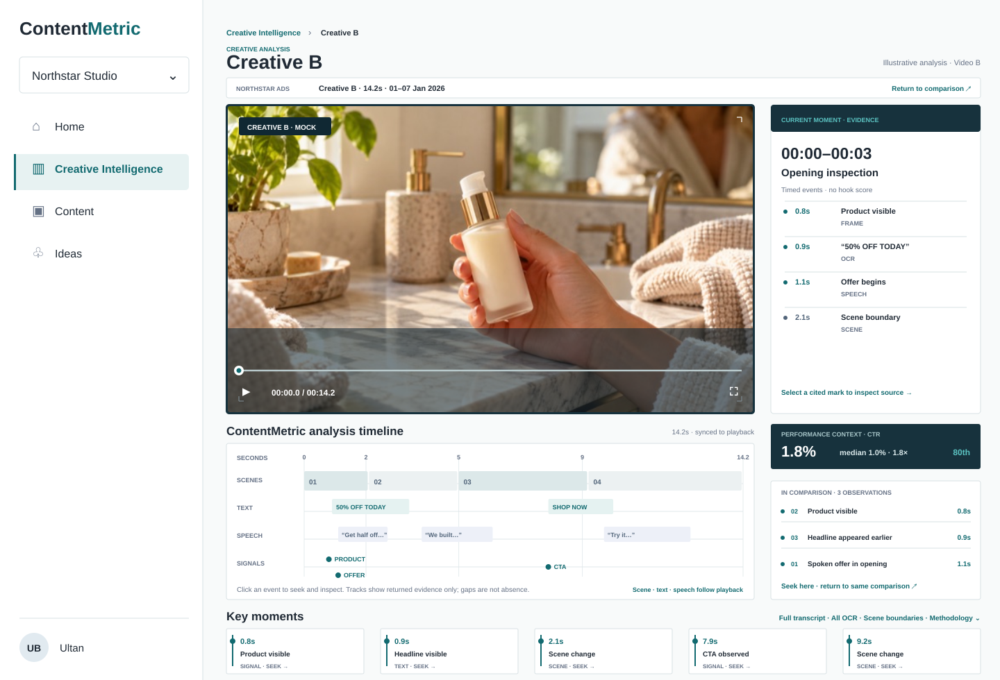 |
| Desktop event selected |  |
| Desktop opened from Creative Intelligence | 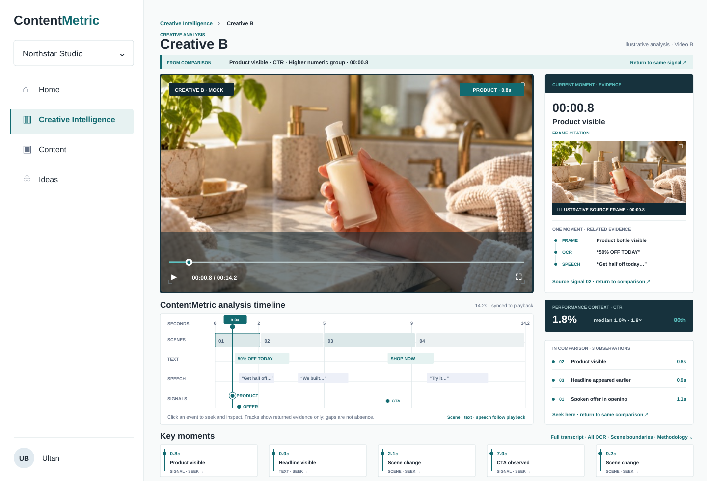 |
| Mobile default | 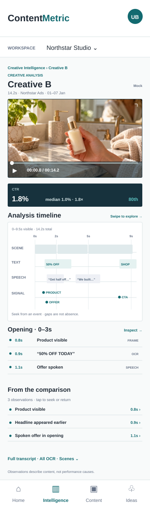 |
| Mobile evidence selected | 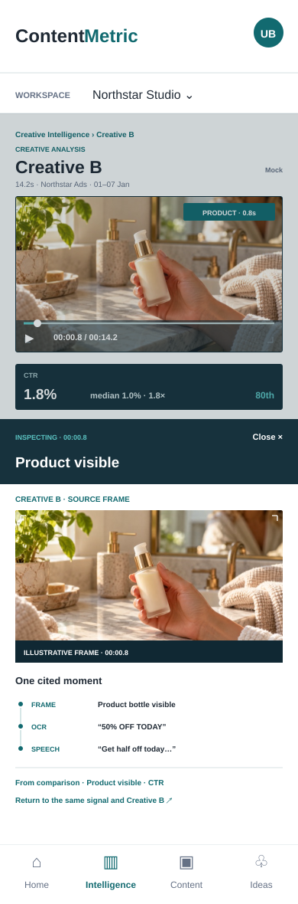 |

### Final name and visual hierarchy

**Recommendation: `Creative Analysis` as the view name, with the creative/ad label as the main page title.** The illustrated header reads `CREATIVE ANALYSIS` above `Creative B`; a real eligible label replaces `Creative B`, with a safe pseudonymous fallback when the label is unavailable. This makes the object being inspected unmistakable and fits alongside Creative Intelligence without sounding like an AI feature. `Creative Breakdown` suggests a more editorial or subjective report; `Creative Review` is too generic and can imply human approval. The phrase **Single Creative Review** remains useful in planning documents but is not the proposed user-facing title. Creative Intelligence is not renamed.

The player is 18px taller than V1 and has a tighter, darker frame, simplified progress/control treatment and a small selected-moment tag. It remains fully above the timeline on a 1440 × 980 viewport; the complete four-lane timeline and the start of key moments also remain visible. The same player image is deliberately reused as a **single illustrative source frame**; other key moments are timestamped seek targets rather than five copies of a fake scene storyboard. Real per-scene keyframes can appear only when an approved media response supplies them. Performance remains a 65px context strip, not another hero.

### Playback synchronization and timeline grammar

The full-duration axis is drawn only when duration metadata is available. Four aligned lanes use the same seconds scale and consistent pale interval tracks: **SCENES** are returned ranges; **TEXT** is returned OCR appearance/disappearance; **SPEECH** is timestamped transcript segments; **SIGNALS** is validated cited observations. Each range retains its type label and exact times on selection. The selected playhead is a shared vertical rule with a time chip. Selected scene, overlapping OCR and active speech intervals receive thin outlines; the selected signal point gets a ring. In the selected-event drawing, `00:01.1` is repeated in the player, playhead and evidence rail. The media label names the selected event, so the player never appears unrelated to the inspector. Hover previews a mark and its source label; click/tap or keyboard activation seeks and locks selection.

During real playback, the playhead follows the player clock. The active scene and timestamped transcript/OCR intervals follow their returned ranges; a semantic point becomes current only at its supported cited moment, or across a supported interval if the accepted analysis actually supplies one. Playback emphasis is subtle and does not imply continuous presence from a sparse citation. Pausing or selecting an event freezes the current-moment inspector; resuming follows playback again unless the user deliberately pins an inspected citation. The timeline never constructs new scene roles, performance explanations or inferred absence from empty space. Transcript detail remains timestamped and seekable in a disclosure rather than a single raw text block.

### Current Moment rail and evidence bundle

The rail gives the exact timestamp first, then event name/modality, source frame, related OCR/transcript and secondary links. Related modalities are visually grouped under **one moment**, not split into independent cards. Only evidence with compatible returned timestamps and refs should appear together; otherwise each item keeps its own time and is inspected separately. Source frames and OCR coordinates require an approved, authorized media/detail response. The concept draws no fabricated object box. The default rail uses a compact **Opening 0–3s** event index; it states timed observations rather than scoring a hook.

**Sticky behavior:** within the Creative Analysis content column, the Current Moment rail stays at the top of the viewport while the user scrolls the timeline, transcript, scenes, comparison links or later detail. It remains inside its column and stops at the end of the review content; it never floats over the video or the V9 navigation. Its selected timestamp and source frame remain visible during investigation. On narrower desktop widths the rail follows the existing responsive stacking order rather than covering the player. The static SVG shows the rail at its initial position; this behavior is specified here, not presented as an extra control.

### Comparison handoff and mobile focus

The deep-link state has one compact line: **From comparison · Product visible · CTR · higher numeric group · 00:00.8**. Opening from a cited evidence point seeks to that exact returned timestamp and selects its signal. Return should restore the same account, metric, exact dates, selected signal, selected creative and scroll/focus where available; this is navigation state, not new analysis or persistence. If the context has expired or the citation cannot be resolved, show the creative from its start and say that the comparison focus is unavailable. The cross-video pattern list stays compact and link-like; it does not repeat comparison findings as inside-video conclusions. `Higher` describes the numeric metric group, not creative quality.

Mobile keeps video → compact performance → swipeable four-lane timeline → active evidence → deeper disclosures. Its selected time appears on the video, on the timeline and in the bottom sheet. The sheet shows one frame and a short aligned evidence bundle; closing it restores the same playhead and horizontal timeline offset. Opening events, scene ranges and transcript segments remain tap targets with comfortable hit areas even when their marks are visually compact. Full transcript, OCR and scene lists stay behind disclosure. The V9 bottom navigation remains visible.

### Implementation boundary retained

These are static design concepts. Current raw processing stores timed transcript segments, OCR and scene boundaries, and Stage 8.2 can return comparison citations. A unified company-authorized playable detail/media response is **not** present in the current Creative Intelligence contract. The mock player, source frame, OCR words, transcript words, 14.2s duration and performance values in V2 must not be treated as live account evidence. Building the illustrated playback/frame inspection would require separately reviewed authorization, media delivery and citation-to-owned-video mapping. Until then, show only data actually returned and an honest citation-only or raw-evidence fallback. No retention curve, quality score, semantic role sequence, causal uplift or new backend inference is implied.

**Archive note:** V1 below established the workstation layout. V2 is the current visual and interaction recommendation for the same five states; Creative Intelligence V8 remains locked.

## Single Creative Review V1 — inside-video analysis for review

**Status:** Design only. The Creative Intelligence comparison screen is locked for this task. Single Creative Review is the second level: **Creative Intelligence compares videos; Single Creative Review dissects one video in time.** These SVGs illustrate the interaction using fictional Creative B, a generated mock still and sample timed evidence. No React, API, analysis, storage or media behavior has been changed.

| Required state | Concept |
|---|---|
| Desktop default |  |
| Desktop selected timeline event |  |
| Desktop opened from Creative Intelligence | 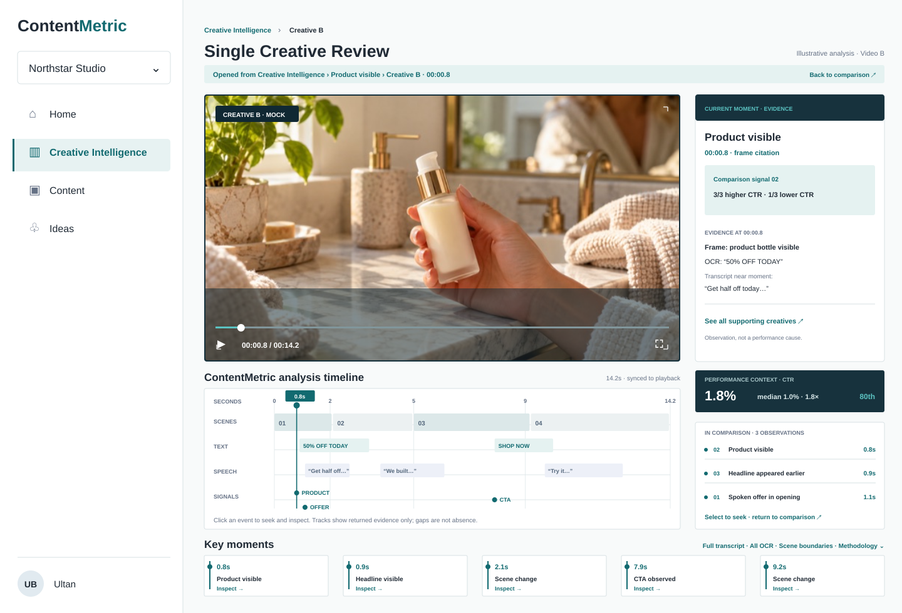 |
| Mobile default | 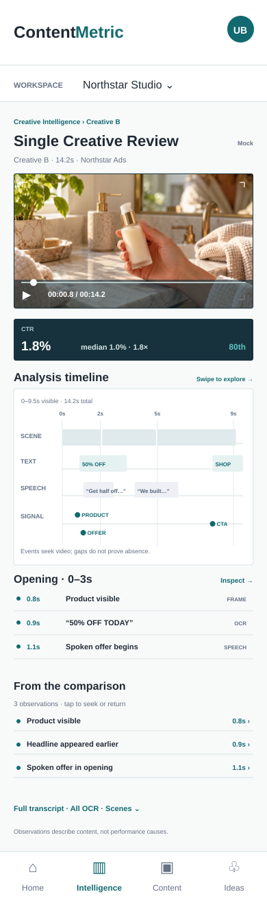 |
| Mobile evidence selected | 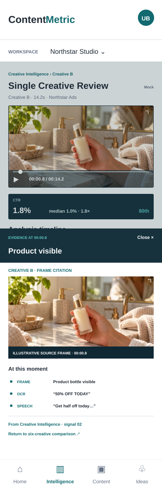 |

### Workstation model

The **video is the primary object**. Its player occupies the main desktop area; a compact current-moment rail sits beside it. The four-track analysis timeline below shows raw scene spans, observed OCR intervals, timestamped transcript segments and validated semantic citations only when available. Performance is a narrow contextual strip in the rail. Comparison participation is a compact list with its three cited observation links. The first viewport therefore exposes the opening, what was visible and spoken, scene rhythm, selected event evidence, performance context and the connection back to cross-video analysis without a summary card or dashboard of metrics.

Every timeline mark has an exact timestamp and modality. Scene blocks use returned start/end boundaries; text uses returned OCR appearance/disappearance timestamps; speech uses returned transcript segment start/end; semantic signal marks use validated citations. A gap on any lane means **no event shown in that lane**, not proof that the feature was absent in the video. Scene cuts describe structure, never quality. The example uses a 14.2s duration from raw metadata, so its axis represents the full clip; if duration is missing, the UI must not draw a full-duration scale. The illustrated timings and text are sample content, not claims about a connected ad.

Selecting a mark seeks the player, holds a playhead at its timestamp, highlights that mark and updates the current-moment rail. The selected desktop drawing demonstrates a timed OCR event. During playback, the playhead and active transcript/scene/text state follow the player clock; scrolling or hovering previews evidence without seeking until selection. Keyboard activation has the same result as clicking. The rail combines frame, OCR and nearby speech only if timestamps and their source refs genuinely support temporal alignment. OCR coordinates may be overlaid on an actual source frame only when supplied with that frame; semantic observations never receive fabricated boxes.

The default rail shows a compact **Opening 0–3s** event index, not a scored “hook.” Key moments beneath the timeline are timestamped jumps rather than repeated fake scene frames. Full transcript, all OCR, all scene boundaries, structured semantic roles and detailed provenance are deeper disclosures. A structure-role band may be added only for accepted `AnalysisReport.structure` spans actually returned for this creative; the concept deliberately avoids a fabricated opening/setup/demo/proof/CTA sequence. If no semantic observations exist, raw timed tracks remain useful and the signal lane simply reports that none were validated.

### Seamless comparison handoff

The deep-link example opens Creative B at its returned Product-visible citation (00:00.8). The small context line says which Creative Intelligence signal opened the review; the same A–F identity, teal citation marker and exact timestamp persist. The current-moment rail shows that citation and its comparison support/counterexample context, while treating it explicitly as an observation rather than a cause of CTR. **Back to comparison** returns to the same comparison and selected signal, preserving scroll/focus where possible. Links in the comparison participation list seek to the corresponding cited moment and can return to the cross-video evidence view. If a passed citation cannot be resolved or access has expired, open the creative at the start with a clear unavailable-context note; do not manufacture a replacement timestamp.

### Mobile behavior

Mobile orders video → compact performance context → swipeable timeline viewport → active opening evidence → comparison links. The timeline uses the same four lanes and exact event semantics; its visible window is labeled **0–9.5s visible · 14.2s total** so horizontal movement does not masquerade as the whole clip. Selecting a mark seeks and opens a focused evidence sheet. The sheet leaves the video visible above it, shows one source frame with timestamp and a short aligned modality list, and returns to the same timeline position on close. The locked V9 bottom navigation remains. Full transcript and event lists stay behind disclosure rather than stacking beneath the video by default.

### Contract and product decisions

The existing processing pipeline produces duration metadata, timestamped transcript segments, scene boundaries and OCR text with appearance/disappearance times and bounding boxes. The existing stored-analysis reader can assemble these raw records, and the experimental semantic report schema can represent validated technique/structure spans with evidence. The current company Content UI exposes a bounded list, while the Stage 8.2 Creative Intelligence product response exposes comparison citations; it **does not provide this unified company-scoped playable detail view, persisted source frames/media URL, or a direct per-creative semantic timeline**. A production Single Creative Review therefore needs a separately reviewed, authorized detail/media response path and a precise mapping from comparison `video_ref`/`evidence_ref` to the owned creative. This design does not assume that temporary server-side media downloads are browser-playable.

The frame, transcript words, OCR words, scene times, visibility interval and 14.2s duration in the drawings are illustrative. Production must use only returned, authorized data; show a citation-only or raw-evidence view where media or semantic evidence is unavailable; and never add attention heatmaps, quality scores, retention curves, subjective hook labels or causal uplift claims. Performance stays exact-context only and does not become an inside-video explanation.

**Review focus:** video dominance, temporal event grammar, current-moment evidence rail, comparison deep link and mobile evidence sheet. The Creative Intelligence comparison concepts below remain locked.

## Creative Intelligence V8 — proprietary Signal Map and Evidence Trace for review

**Status:** Design only. V8 keeps the approved shell, compact controls, dark performance strip, six creative comparison, density, experiment structure, drawer and mobile navigation. It changes the analytical interaction inside the Signal Map and Evidence Trace. The Northstar values, six generated stills and sample evidence copy in these SVGs are illustrative, not connected account data.

| State | V8 drawing |
|---|---|
| Desktop default result |  |
| Desktop signal 02 selected |  |
| Desktop Evidence Trace | 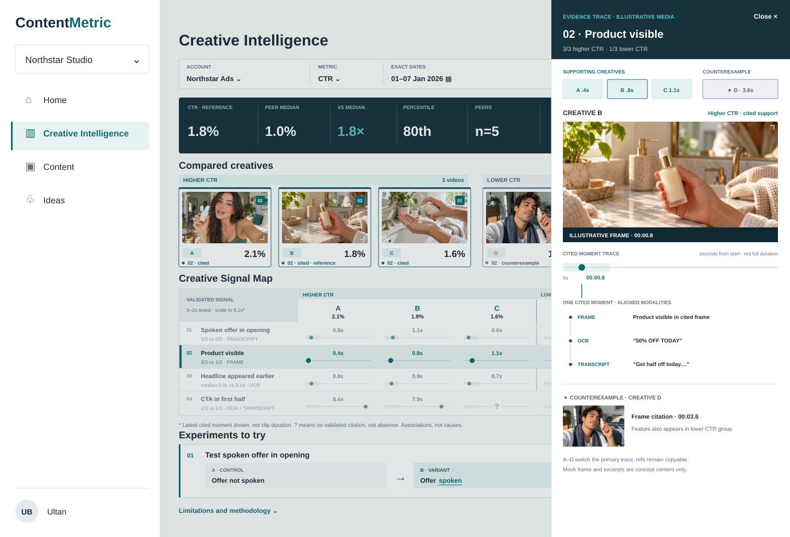 |
| Mobile Signal Map result | 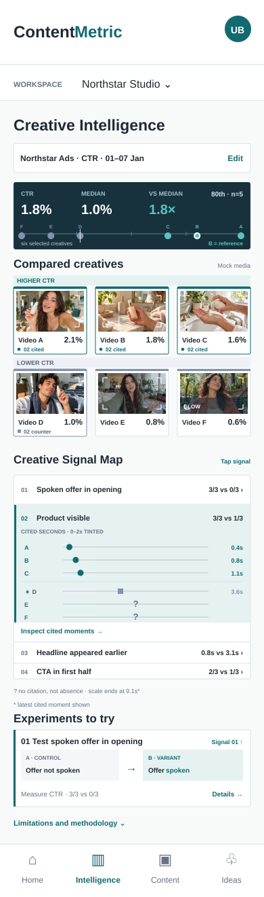 |
| Mobile Evidence Trace | 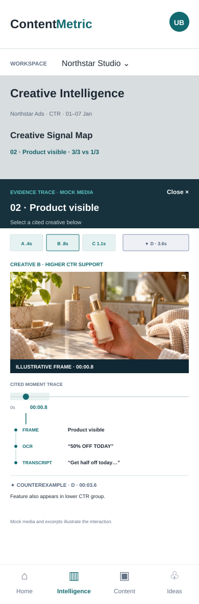 |

### Signal Map visual grammar

The six creative identities A–F stay aligned in the performance distribution, media strip, Signal Map and Evidence Trace. A–C use the existing teal higher-*numeric*-metric treatment; D–F use the neutral slate/indigo lower-*numeric*-metric treatment. Group colour never means winner/loser or better/worse, including when the selected metric is CPC or CPM. The map still has validated observations as rows and creatives as columns, but each intersection is drawn as a **citation trace** on a shared scale instead of a boxed data cell. Continuous rails, a repeated literal **0–2s** tint, and aligned evidence markers make an early cluster visible across a row before the user reads the timestamps. One separator divides the cohorts; light row bands replace most grid rules. Exact seconds and returned support summaries remain readable.

All traces are **seconds from video start**. The illustrated scale ends at the latest cited timestamp in the visible map (9.1s); the asterisk states that this is **not video duration**. The 0–2s tint is a numeric region, not a newly inferred semantic “opening” class. A cited dot is positioned from its returned `timestamp_seconds`; multiple citations for a creative would need multiple markers or a count plus inspection. The dot does not claim first occurrence or continuous presence between sparse sampled frames. A teal circle means a supporting citation; a slate diamond means a returned counterexample. `?` means there is no validated citation for that row and creative, **not** that the feature was absent. V8 does not render an absence dash because the current response does not establish per-video absence. An unavailable citation and a contradicted observation must remain distinct.

The illustrated selected row is **Product visible**, with support A–C and a lower-group counterexample D. The D marker is deliberately visible at its cited time and in the creative strip. The example's A–D times illustrate the trace interaction; they must not be interpreted as a backend-validated timing difference merely because their positions differ. For live data, use only returned observations, evidence refs, timestamps, group members and support/counterexample roles. Do not derive a new observation from where markers happen to sit.

### Focus and evidence interaction

Selecting a signal holds the rest of the workspace in place: its trace band and exact markers strengthen, related A–F thumbnails show matching signal identifiers, counterexamples retain their distinct slate marker, and other rows recede without disappearing. Hover previews; click, keyboard activation or tap persists selection. Selecting another signal replaces focus. Creative selection still flips focus to that video's cited signals using the same visual grammar. Evidence opens beside the map on desktop so the selected trace remains partially visible; closing returns to the same signal and scroll position. The drawer should never become a separate report page.

The **Evidence Trace** has one primary inspector with quick switching among A, B, C and counterexample D. The large frame, creative reference and exact timestamp lead. A compact cited-moment rail pins one moment; frame, OCR and transcript evidence align to the same temporal stem **only when their returned timestamps genuinely converge**. When timestamps differ, show separate pins with their own exact times. The secondary counterexample remains visible below the primary moment, with neutral treatment and a one-line relationship: the feature also appears in the opposite metric group. Full returned references remain available to copy in implemented detail. No synthetic bounding box, inferred video duration, or fabricated continuity is allowed. Existing OCR regions could only be drawn if the approved product response explicitly supplies them.

**Current contract boundary:** Stage 8.1/8.2 provides pseudonymous video/evidence refs, evidence type and cited timestamps, but does not provide source frame URLs, video duration or bounded OCR/transcript excerpts in the product response. The media-rich V8 inspector is a design illustration of a future approved response path. Under today's locked contract, its real implementation must be a citation and timestamp trace with no invented frame or excerpt. The browser still sends only account, metric and exact start/stop dates; server reasoning and validation remain authoritative.

### Mobile and experiment continuity

Mobile retains the compact controls, performance strip, two three-video media rows, one expanded signal and A/B experiment. The expanded signal becomes six short horizontal traces grouped higher/lower; one cited-time scale and exact right-edge values make the contrast legible without a six-column spreadsheet or long cards. Touching a marker opens a focused Evidence Trace sheet with the same A–D switcher and one primary cited moment. Closing restores the active signal. The experiment's existing **Source signal 01** control reactivates its matching map row only when its returned `source_difference` matches an observation unambiguously. It does not introduce a new recommendation or analysis rule.

**Review decision:** Approve the trace interaction as the target visual model while keeping the citation-only production fallback, or separately approve a media/excerpt response contract before treating the illustrated frame and multimodal copy as implementable. No application code is changed by these concepts.

**Archive note:** V7 below introduced the Signal Map. V8 is the current review concept for its visual grammar and Evidence Trace; the surrounding V7 structure remains locked.

## Creative Intelligence V7 — Creative Signal Map concept for review

**Status:** This is a **design-only interaction concept**. The approved shell, compact comparison toolbar, dark performance strip, six creative tiles, compact A/B experiment and evidence drawer remain in place. V7 replaces the ordinary findings matrix with the **Creative Signal Map**. The drawings use the same fictional Northstar comparison and generated mock media as V6. All times, text and evidence examples are illustrative; no browser or server contract changes are proposed.

| State | V7 drawing |
|---|---|
| Desktop default result | 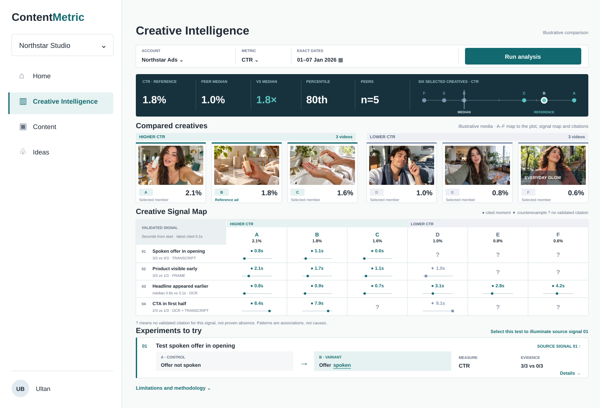 |
| Desktop signal 02 selected, including counterexample |  |
| Desktop creative B selected | 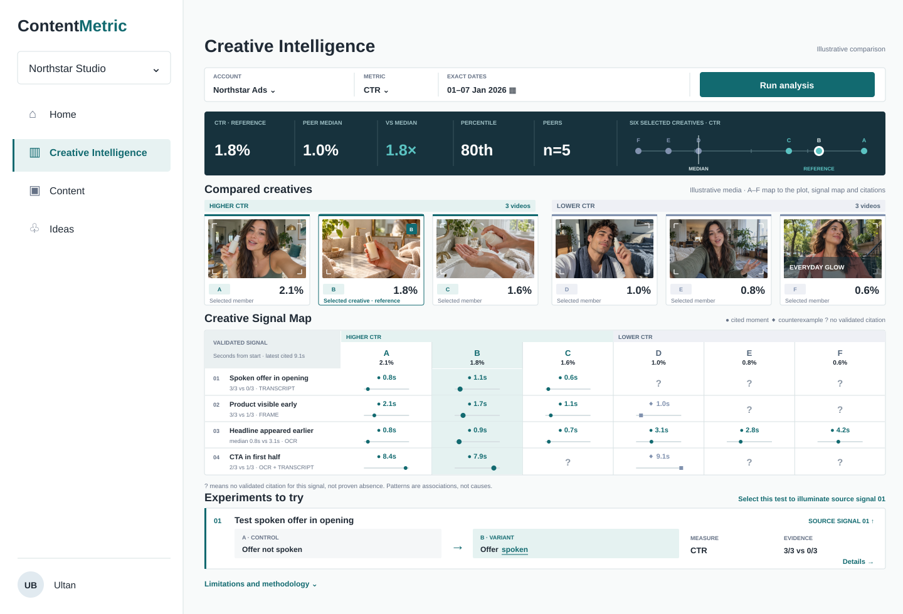 |
| Desktop evidence drawer | 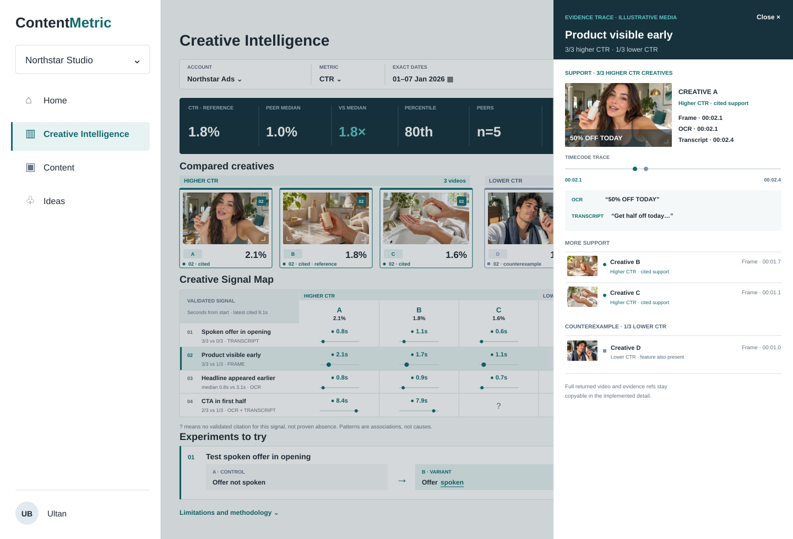 |
| Desktop experiment selected | 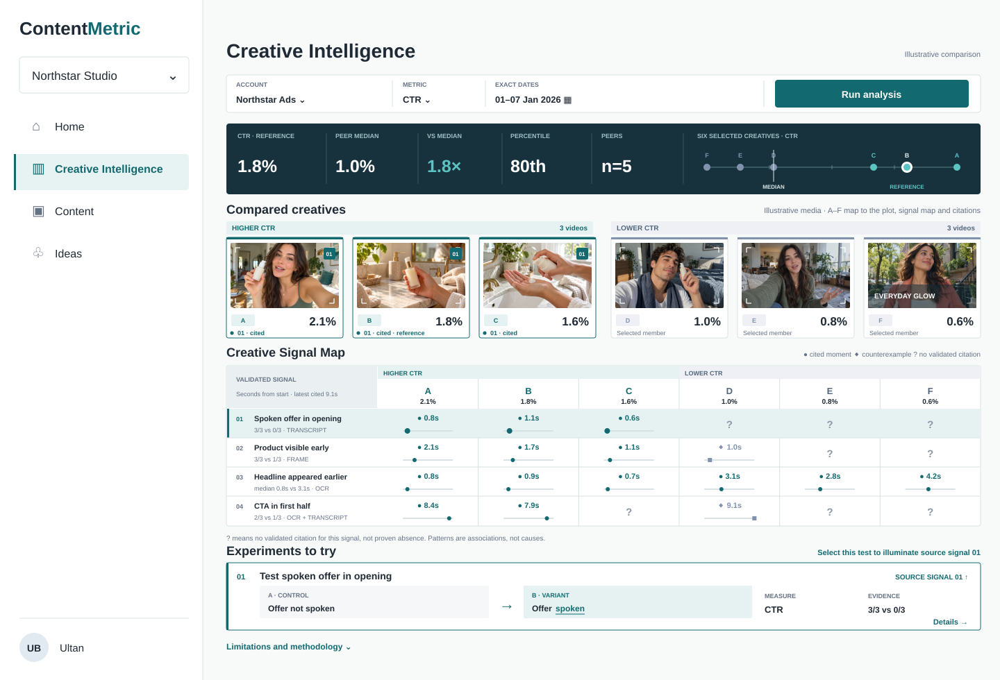 |
| Mobile result with one signal expanded | 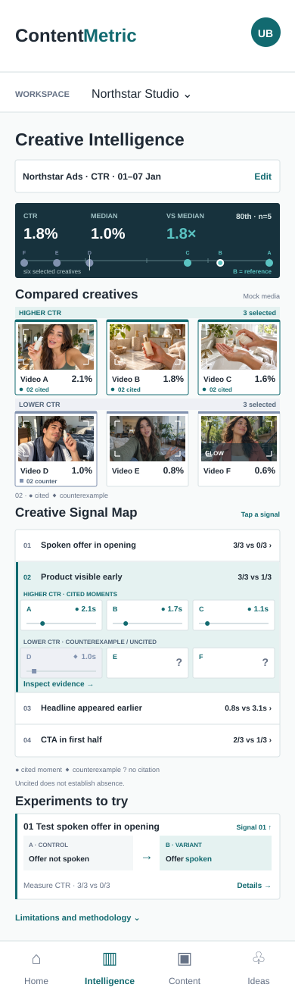 |

### Signal map model

The map is a **cross-video citation index for validated observations**, not a claim that ContentMetric has exhaustively labeled every moment of every video. Its rows come only from returned `content_differences`/validated `observed_differences`; its six columns come from returned `cohort.content_groups` members. A–F are stable *within this comparison* and recur in the dark performance strip, thumbnails, map, evidence drawer and source experiment. Each row retains the returned observation meaning, evidence modality and support/timing summary. The illustrated four rows are examples; a live result shows only validated rows, including zero rows in an abstention state.

A cell renders each returned citation for that row and video as a **cited moment** with its exact `timestamp_seconds`. The mini track uses a shared seconds-from-start scale across the visible map, ending at the latest *returned cited timestamp shown* (9.1 s in the example). It is **not a clip-duration timeline**, a claim of first occurrence across the whole video, or evidence of what happened between sampled frames. If a video has multiple returned citations for the same row, show multiple small markers or a compact count with a detail disclosure; do not silently choose one and label it “first.” The illustrated single-dot cells each represent one cited moment. Equal times align; a longer time appears farther right. No time-series data or causal model is created.

| Cell mark | Meaning now | Display rule |
|---|---|---|
| `● 1.2s` | Returned supporting citation at that timestamp. | Keep time as text beside the mark; source type/ref live in inspection. |
| `◆ 1.0s` | Returned counterexample citation. | Slate/indigo mark, visibly distinct from support; never a red failure state. |
| `?` | No validated citation for this row/video in the response, or insufficient evidence to make a cell claim. | Do **not** translate to absent, zero, or “not seen in the video.” |
| `—` | Explicitly validated absence, if a future response ever defines it. | **Not used in V7:** the current response has no per-video absence fact, and sparse frames cannot prove continuous absence. |

The row summary can still read `3/3 vs 1/3` because that count is returned by server validation. The two uncited lower-group cells remain `?`: the count does not license a browser claim that those videos never show the feature. When model/media coverage is partial, keep valid cited cells and use `?` for unsupported cells, plus the returned limitation. No generic “hook strength,” creative score, inferred semantics or invented signal row is allowed.

### Connected selection behavior

- **Default:** six labelled video frames, six corresponding performance dots, and the map appear together. The map groups A–C as higher **numeric CTR** and D–F as lower **numeric CTR** in the illustration. For CPC/CPM the same colour still means higher/lower number, never better/worse quality.
- **Select signal 02 · Product visible early:** the row tint and `02` marker match teal citation markers on A–C. D receives a slate `02` counterexample mark; E/F recede slightly but their metric values remain readable. The selected row makes exact cited moments prominent. **Inspect evidence** opens the drawer for that row without navigation. The same treatment applies to keyboard focus and touch selection; hover previews it without locking.
- **Select creative B:** B's thumbnail, performance dot and map column become the focus. Returned citations for B across all validated rows remain visible in that column; this is the creative-first view of the same data, not a new report. Select another creative to replace the focus; clear selection to restore the full map.
- **Select the experiment:** its returned `source_difference` must match one validated observation unambiguously. Then source signal 01 and its cited creatives light up, connecting the test to its observational basis. If there is no exact, unambiguous returned source match, show the experiment without a map link. The experiment does not claim the observation caused performance.
- **Counterexample:** D is prominent both in the selected row and in a separately headed drawer section. Its feature citation remains inspectable alongside A–C; a minority citation is not hidden to make the pattern look cleaner.

The source map is driven by returned `evidence_refs`, `counterexamples`, `supporting_video_refs` and group members. It never reconstructs or revalidates an observation client-side. Selection changes emphasis and disclosure only. The same neutral teal/slate palette carries across performance dots, tiles and map marks. Small shared row numbers serve as evidence connectors without crossing lines or a large diagram.

### Evidence and experiment connection

The desktop evidence drawing retains V6's media-rich **illustrative future state**: Creative A's mock frame and sample OCR/transcript copy, B/C support entries and D counterexample. V7 places that drawer beside the selected signal map so the chosen row, its cited cells and its source trace stay recognisable at once. The timecode line in the drawer groups cited moments; it does not assert clip duration. The current Stage 8.1/8.2 response returns `video_ref`, `evidence_ref`, `evidence_type` and `timestamp_seconds`, but **no thumbnail/frame URL or bounded OCR/transcript excerpt**. Under the locked contract, use the citation-only V5 inspector; do not present the fictional V6/V7 media or quotes as actual account evidence. A media-rich implementation requires a separately approved response path.

The experiment retains the compact A/B anatomy and highlights one changed variable. Its **Source signal 01** link is deliberately adjacent to the test title. Selecting it changes map/creative emphasis, not metric calculations or the hypothesis. The user can go from observed signal → supporting/counterexample videos → cited moments → controlled test, and reverse from a test to its returned source observation.

### Mobile adaptation and density

Mobile uses **pattern-focused expansion** rather than squeezing six data columns onto a phone. The six thumbnails remain in two compact cohort rows. The map shows four short signal rows; one active row expands into a 2 × 3 comparison of A–F with cited timestamps or `?`, using the same teal support and slate counterexample roles as desktop. Another tap changes the active row; evidence opens in the existing sheet and returns to the same row/scroll position. The source experiment remains compact below the map. No horizontal data table or six giant stacked cards appear.

At 1440 × 980, the desktop drawing still keeps the toolbar, 102 px performance strip, all six media tiles, four map rows and the first experiment in one viewport. The map's header and 42 px signal rows carry more relationships in roughly the former pattern area. This is a structural change **only to the analytical surface**, not to the locked page flow or shell. The only additional vertical space on mobile is the one expanded signal, which the user controls.

### Product decisions exposed

1. **No absence claim from silence.** The current contract can support cited moments and returned counterexamples, but not a per-video “never occurred” cell. `?` is the honest default for uncited cells. An explicit absence symbol must wait for a future validated absence field and coverage rules.
2. **No exhaustive video timeline.** Citations have timestamps; the product response does not promise that these are the first occurrence in the full video or supply a complete duration-aligned event stream. The shared map scale compares cited times only.
3. **No invented signal taxonomy.** Short illustrated labels are design copy; production rows preserve returned validated descriptions. Fixed modality/group labels may organise them, but the client does not derive “Product,” “Demo,” or “Hook” classes independently.
4. **No speculative experiment link.** The returned `source_difference` provides a possible exact link to an observed row. Ambiguous or missing matches remain unlinked.
5. **Media is still illustrative.** The six generated frames and mock OCR/transcript lines are concept assets. Real source imagery and excerpts need an approved media contract; the browser request remains only account, metric and exact dates.

## Creative Intelligence V6 — final visual polish for review

**Archive note:** V6 remains the media and evidence visual reference; V7 above replaces its findings table with the Creative Signal Map.

**Status:** V6 finishes the approved V5 structure. The flow is locked: compact controls → performance strip → six compared creatives → detected patterns → compact experiments → evidence on demand. These are **design-only SVG concepts**. No React, CSS, browser request, server response, analysis rule, navigation or shell change is proposed. Northstar Studio, values, findings, media, copy and timestamps in these examples are illustrative. The six photographs are generated fictional paid-social stills, **not frames from a connected Ads account**.

| Polished state | SVG |
|---|---|
| Desktop full result | 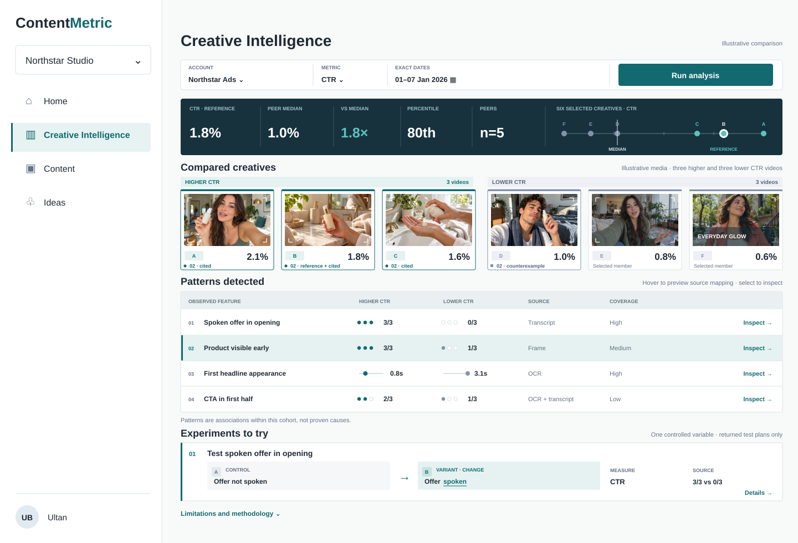 |
| Desktop evidence drawer | 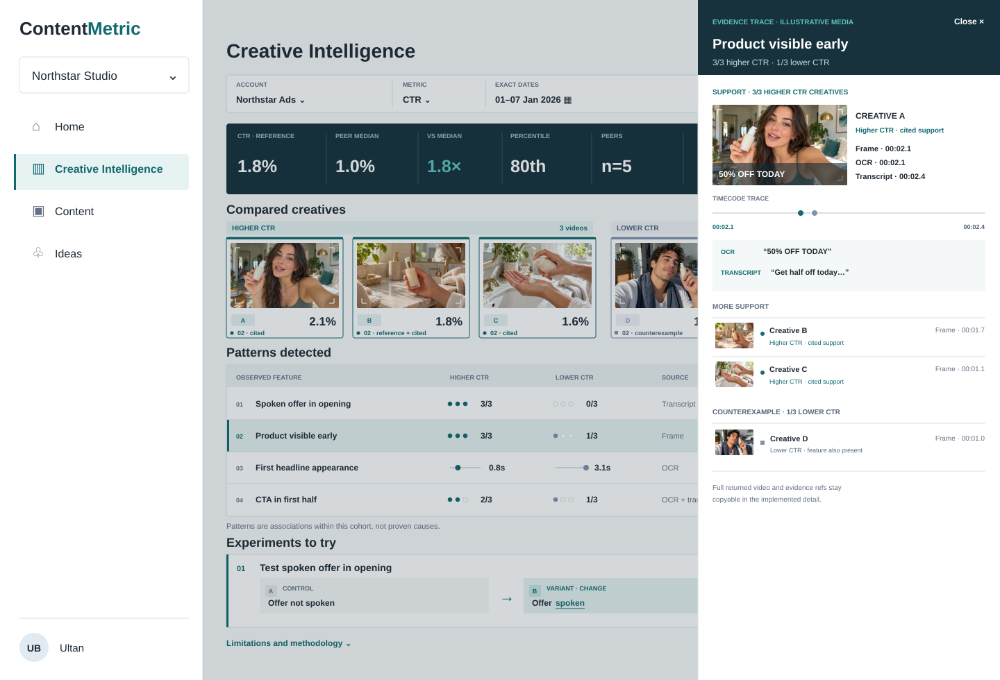 |
| Mobile full result | 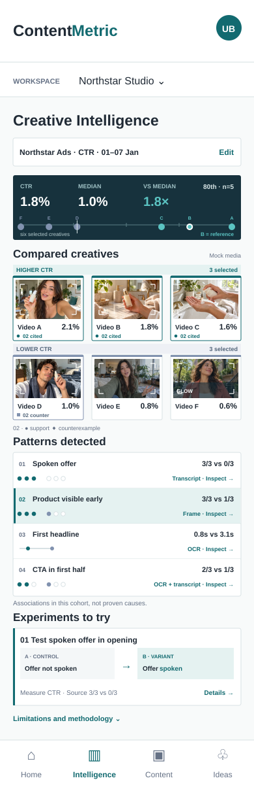 |
| Mobile evidence sheet | 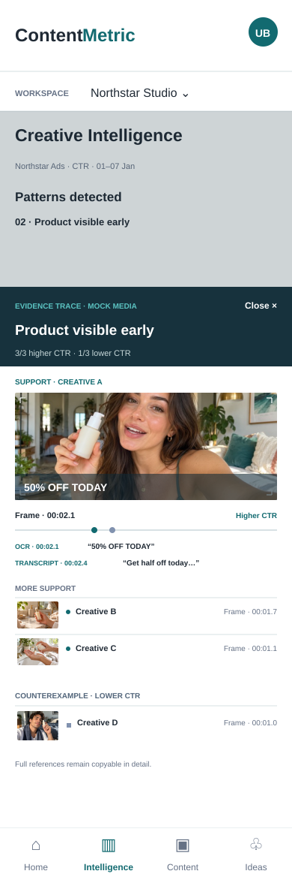 |

Ready, performance-only partial and no-linked-Ads states retain their [V5 ready](design/creative-intelligence/v5/creative-intelligence-desktop-ready.svg), [V5 partial](design/creative-intelligence/v5/creative-intelligence-desktop-partial.svg) and [V5 prerequisite](design/creative-intelligence/v5/creative-intelligence-desktop-no-ads.svg) concepts. Their structure and recovery rules are unchanged. V5 remains the baseline for missing-media and citation-only presentation.

### Creative-media treatment

The six member tiles keep their original two groups and metric values. The media window grows from about **73 px in V5 to 94 px in V6** (approximately 29% more image height), while the entire tile grows only from 124 to 145 px. The screen still shows all six videos and four pattern rows before the experiment. The media is intentionally varied within one fictional skincare campaign: creator-to-camera, product reveal, hands-on demonstration, another creator with product, a creator-only frame and an outdoor lifestyle frame with an illustrative text overlay. Photo colour supplies personality; frame brackets, compact metric labels and neutral group colours keep it recognisably ContentMetric. The six selected members remain a cohort sample, not all ads in the account.

The mock stills are saved in `design/creative-intelligence/v6/media/creative-a.jpg` through `creative-f.jpg` and embedded in the SVGs so the drawings render alone. **They must never be treated as returned thumbnails or customer evidence.** The current intelligence response provides group-member video references and metric values but no thumbnail URL or frame image. Actual production frames require an explicitly approved media path; absent that, the honest citation-only V5 treatment remains the implementable state.

### Pattern ↔ creative connection

The illustrated selected row is **02 · Product visible early**. Its returned-shape comparison is `3/3` higher CTR and `1/3` lower CTR. A–C share a thin teal outline and small `02 · cited` marker; D has a slate counterexample marker; E/F are slightly subdued. The selected row uses the same `02` marker, soft teal tint and a narrow left rule. That visual vocabulary makes the claim-to-source path visible without lines crossing the table. The backend's `evidence_refs`, supporting video refs and returned counterexample refs determine these roles; the client never infers support from a metric value or a photograph. Higher/lower colour remains directional, not good/bad.

Interaction states for implementation review:

| Element | Rest / hover / selected |
|---|---|
| Creative | Rest shows frame, video ref and metric. Hover raises border contrast and reveals the full pseudonymous ref. Selected keeps the border and its citation role; unrelated members dim only modestly so values remain readable. |
| Pattern row | Hover previews matching source markers on the six creatives. Click, Enter or Space locks the row, tint and mapped markers. A second row replaces the mapping. |
| Evidence action | Opens the detail for the active row, preserving row selection. Escape/Close returns focus to the triggering action; the drawer/sheet scrolls independently. |
| Evidence entry | Hover/focus emphasises the corresponding member tile when visible. Counterexamples retain their distinct slate marker. |
| Experiment | Hover/focus adds subtle border emphasis and reveals **Details**; it does not animate or expand the row by default. |

Use short colour/border transitions (roughly 120–160 ms) and no movement that shifts the dense table. Touch has no hover dependency: tapping a pattern selects it, then **Inspect** opens evidence. On mobile, the evidence sheet keeps the locked bottom navigation and returns to the same scroll position.

### Performance and pattern visual refinement

The dark strip stays **102 px high**. Its distribution now labels all six plotted members A–F, uses teal for the higher numeric metric group and slate for the lower group, rings B as the selected reference, and marks the returned peer median. The dots use only returned group `metric_value` entries; the reference, median, ratio and percentile remain server values. The illustrative `1.8%`, `1.0%`, `1.8×`, `80th` and `n=5` are mutually coherent with the six pictured values. If values tie, the live rendering should separate/stack labels for legibility without changing the numeric position. If member values are unavailable, omit the dots rather than fabricate a distribution.

The matrix keeps four 46 px example rows. Support remains exact `x/3` text plus small dots; timing remains exact returned medians with a small comparative position cue. Source labels now use the full evidence modality where space allows, including `OCR + transcript`. The `02` selected treatment and row-level Inspect action convey interactivity. There is still one causal qualification under the matrix; detailed limitations remain on demand. No quality score, uplift, significance, creative grade or extra metric is introduced. The example's `2/3 vs 1/3` row carries **Low** evidence-coverage confidence, consistent with the current validation rule.

### Evidence drawer and trace

The desktop inspector and mobile sheet present one selected observation with a featured cited creative, its group role, frame, timecodes, compact OCR/transcript lines, two more cited higher-group creatives and a separately headed lower-group counterexample. The photo and overlay in Creative A, and the sample lines `“50% OFF TODAY”` / `“Get half off today…”`, are **fictional mock evidence** used to show the intended visual finish. They are not returned OCR/transcript data. The horizontal trace groups the illustrated `00:02.1` and `00:02.4` moments; it is deliberately **not duration-scaled**, because the current response does not return a playable clip/duration for this view. Full returned `video_ref` and `evidence_ref` need a copyable route in the future implementation even when compact labels are shown.

**Contract gate:** Stage 8.1/8.2 citation objects currently return `video_ref`, `evidence_ref`, `evidence_type` and `timestamp_seconds`, not media images or bounded text excerpts. The pictured media-rich trace describes the desired appearance *if* an approved response supplies those assets. Under today's locked contract, use the V5 citation-only inspector; do not render the mock quotations or photos as product facts, fetch raw frames indirectly, expose prompts/model responses, or imply that a photo proves the observation without a matching returned citation. This polish pass changes no backend behavior.

### Experiment and mobile finish

The experiment remains one 105 px row. Small **A · Control** and **B · Variant** tags, a single arrow and a teal underline on only **spoken** make the controllable change clear. Measure CTR and the source `3/3 vs 0/3` remain visible. Full constants, source observation, counterevidence and limitations stay in Details. The test wording is illustrative; a live row uses only the returned hypothesis/control/variant/metric and never predicts lift.

On mobile, the six media windows grow while staying in two compact three-item cohort rows; the selected `02` markers and subtle de-emphasis survive at small size. The dark comparison strip plots the same A–F positions, four dense pattern rows remain scannable, and the A/B experiment stays about 118 px high. The evidence sheet foregrounds the featured frame and paired timecodes, then shows B/C support and D counterevidence without turning the result into a long report. At narrower widths the creative roster may scroll horizontally with group headings and a visible next-item cue; no horizontal data table is introduced.

## Creative Intelligence V5 — visual personality pass for review

**Archive note:** V5 established the visual language and citation-only fallback; V6 above supersedes its four full-result and evidence illustrations.

**Status:** V4's dense information architecture is retained: compact controls → performance → six compared creatives → patterns → experiments → evidence on demand. V5 changes visual treatment and linked inspection behavior only. It is a **design concept**, not an implemented UI or a change to the Stage 8.1/8.2 request or response. Northstar names, dates, metric values, observed patterns and citation timestamps in the drawings are internally coherent **illustrations**, not real customer results. All production values and rows must come from the server.

| State | V5 concept |
|---|---|
| Desktop ready/input | 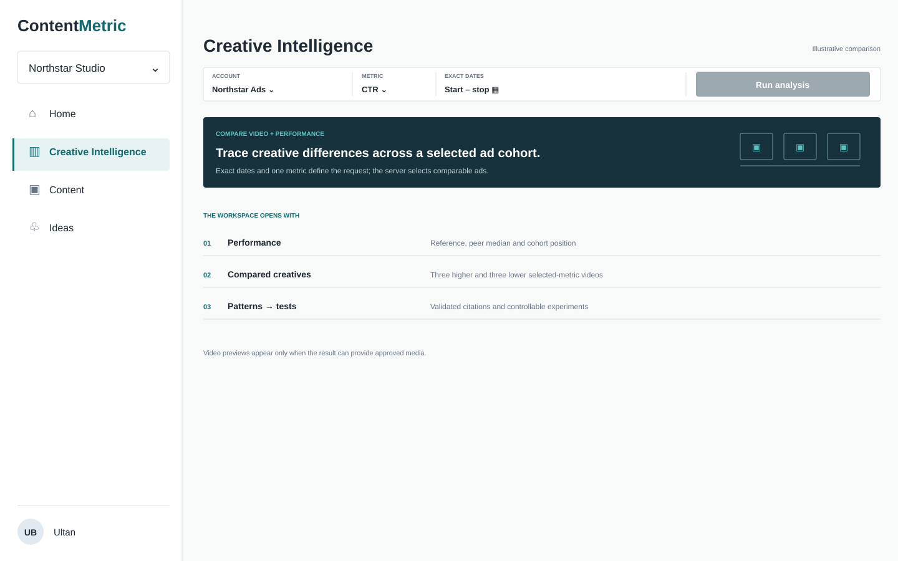 |
| Desktop full result | 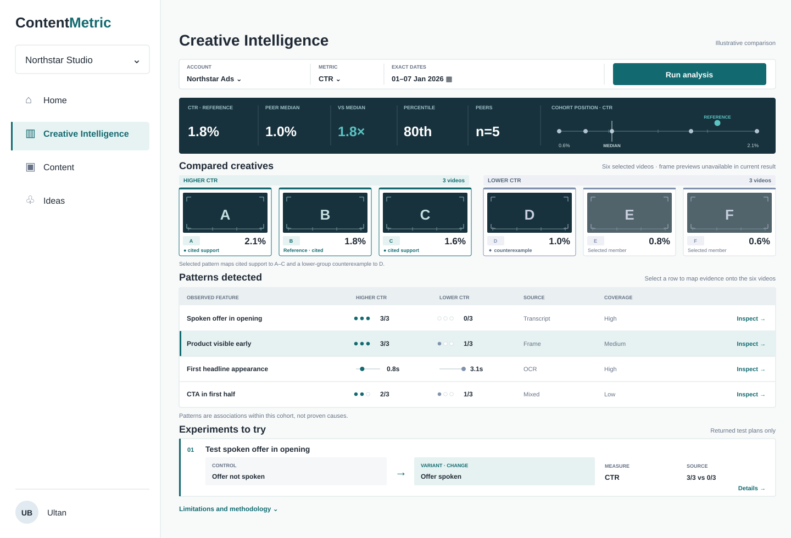 |
| Desktop partial/performance-only | 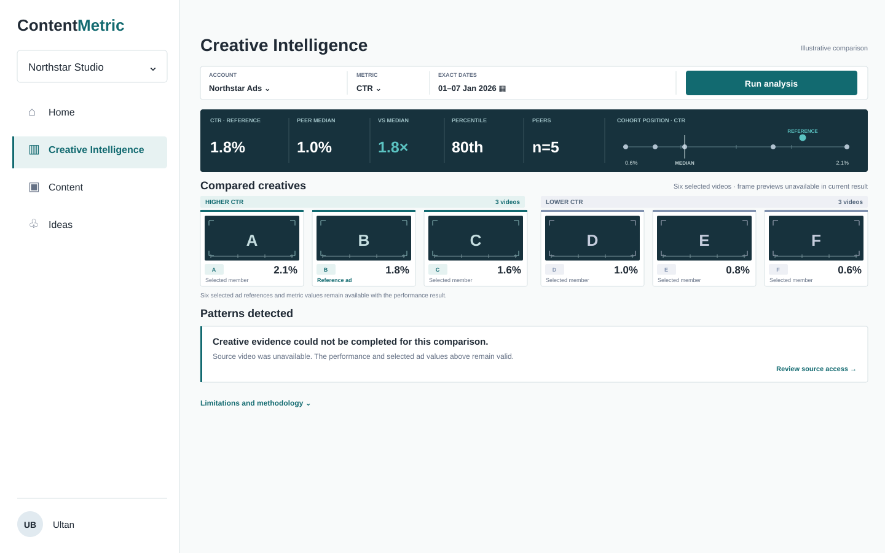 |
| Desktop no Ads account | 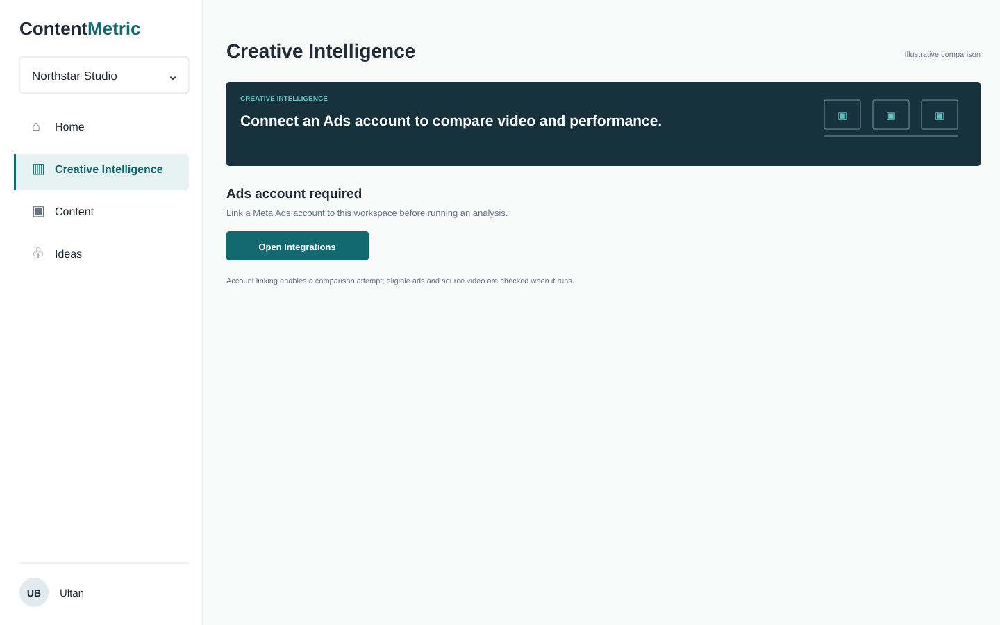 |
| Desktop evidence/detail | 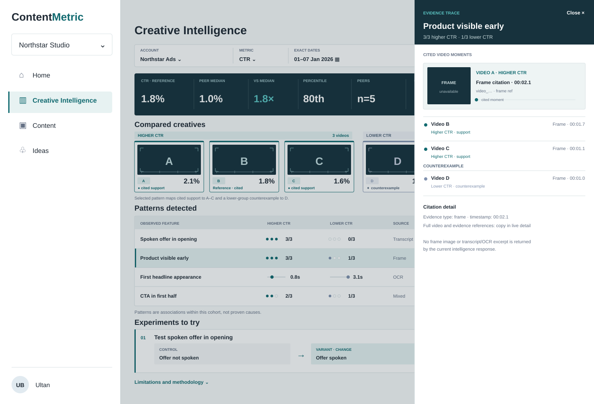 |
| Mobile full result | 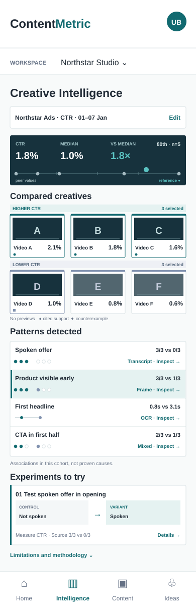 |
| Mobile evidence/detail | 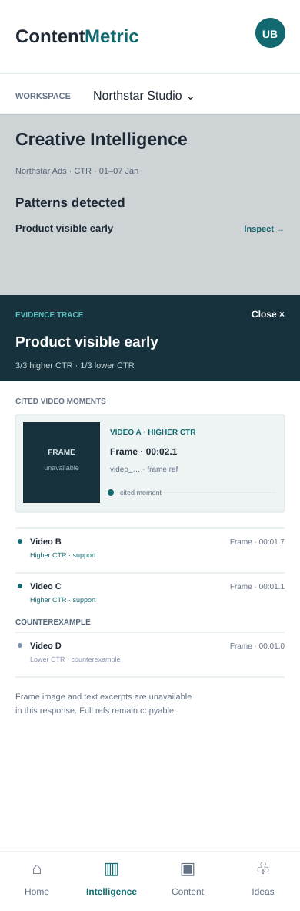 |

### Point of view

V5's recognisable language comes from **video frames plus measurement**: fine corner brackets around each media slot, a short scrubber-like baseline, precise numerical typography, citation dots and one dark cohort instrument. These marks support the comparison rather than decorating it. The dark performance strip is the strongest surface; the six videos form the visual center; patterns are a dense, lightly tinted matrix; the experiment is a compact control/variant transformation. Teal identifies the *higher numeric metric group* and slate/indigo the *lower numeric metric group*. Neither colour means good or bad. The locked ContentMetric shell and mobile navigation stay unchanged; the page does not become a separate dark or “AI” application.

### Video prominence and the current media limit

The six selected members now occupy a full-width comparison band with two three-video cohorts. Every tile shows a dedicated media area, a pseudonymous reference, the selected metric value, and an evidence role when a finding is selected. The frame brackets and time rail make the object read as analysed video rather than a generic KPI card. On mobile the six remain visible in two compact three-item rows, with group colour carrying through the tiles. When a selected pattern is mapped, cited support appears on A–C and a lower-group counterexample on D in the illustration; unrelated members recede. These are illustrative references and roles, never inferred from metric values.

**Important unresolved product dependency:** the locked intelligence response does **not** provide thumbnail/frame URLs for group members, and its citation objects do **not** provide frame images or transcript/OCR excerpts. The SVGs deliberately say **“preview unavailable”** and show no invented footage. This pass cannot truthfully fulfill the request for *actual* video frames under the unchanged contract. The frame area defines where an approved returned thumbnail would appear; a real thumbnail must only render if a future approved media response supplies it. Until then, the visual center is a six-member video roster, not six photographs. The evidence inspector likewise shows returned citation identity, type and timestamp rather than fabricated image/text content.

### New compact visualisations

- **Cohort position strip:** a dark 102 px panel combines returned reference value, peer median, ratio, percentile and peer count with a small dot plot of the selected metric values returned for the six group members. The highlighted reference point, peer dots and median marker make relative position visible without a fake trend or benchmark. The drawing's points use its illustrated six values; a live plot must be computed solely from returned `metric_value` members and returned reference/median, with labels and scale reflecting those values. If group member values or median are missing, omit the plot rather than extrapolate. No statistical significance or quality label is implied.
- **Pattern support:** each support cell keeps the exact returned `x/3` count and adds three small filled/empty dots. The dots are a direct rendering of `higher_group_support`, `lower_group_support` and returned group size, not a new score. Timing rows show a tiny paired position cue alongside the returned timing values; the concept's `0.8s` and `3.1s` are illustrative. The visual cue must be scaled only from those returned values and never stand in for an unavailable duration or continuous-video claim. Evidence type and coverage confidence remain scannable text.
- **Experiment anatomy:** the first experiment uses a neutral control block, one directional arrow and a teal-tinted variant block. The changed variable is visually located in the variant. Measure and source comparison remain visible on the same ~105 px row. All wording comes from the returned hypothesis, control, variant and metric; complete constants, source observation, counterevidence and limitations stay in **Details**.

### Finding-to-creative interaction

Selecting or focusing a pattern highlights only videos named in that pattern's returned `evidence_refs`/supporting references. A returned counterexample gets the slate diamond treatment; videos with no cited role become quieter without disappearing. The selected matrix row receives a subtle tint and left rule, and the six-video band remains in view. This is a **claim-to-source map**, not proof of causation or a client-side reclassification. The concept selects “Product visible early”: A–C are cited support and D is a lower-group counterexample, consistent with its illustrated `3/3 vs 1/3`. If the server returns a different reference set, the highlighting follows it exactly. Hover previews the relationship; click/tap locks selection so keyboard and touch users can inspect it. **Inspect** then opens the evidence drawer/sheet for that same row; closing restores focus and selection.

The evidence view uses a stronger dark header and a compact citation trace. It shows the selected observation, group counts, cited videos, evidence types, timestamps, supporting group and counterexample role. Exact returned `video_ref`/`evidence_ref` must remain accessible and copyable in the implemented detail, even when compact labels are shown. The line beside a citation marks a cited moment; it is **not a duration-scaled timeline**, because video duration is not returned in the product response. A real scaled timeline, synchronised frame, OCR or transcript excerpt would require the relevant media/text and duration to be explicitly supplied by a future approved contract. Raw prompts, model responses and unsupported frames remain excluded.

### Density and state discipline

The desktop result still places controls at y=108, the 102 px performance strip at y=178, all six videos at y=342–466, four illustrated pattern rows at y=557–742, and the first experiment at y=799–904 in the 1440 × 980 drawing. A laptop viewport therefore exposes the comparison, the cohort, several patterns and the start of a test before scrolling. The dark strip, video frames, support dots and A/B block replace flatness **without increasing section count or reverting to large cards**. Mobile uses an approximately 99 px performance visual, six 86 px video tiles, 56 px pattern rows and one 118 px experiment. Evidence stays in a sheet; technical detail does not elongate the main result.

Ready, partial and no-account states use the same dark instrument, frame/tick motif and teal/slate semantics. Ready contains no preview data; no-account contains no disabled form. Partial preserves valid performance and returned group values, then scopes the missing creative analysis to a short message and one recovery action. The other degraded-state rules in V4 below remain in force. The single causal qualification stays under the matrix; deeper method and limitations remain behind disclosure.

### Product decisions exposed

1. **Real thumbnails and evidence imagery need a media delivery decision.** These drawings do not pretend current citations contain a viewable frame. Supplying actual image URLs, bounded text excerpts or a playable video would be separate backend/product work, outside this design-only pass.
2. **The cohort plot is descriptive.** Its dots represent returned selected-ad metric values; percentile and peer median remain the server's values. It must not imply a full distribution beyond those members.
3. **Group colour is directional, not evaluative.** For CPC or CPM, teal still means a higher numeric value, not superior performance.
4. **Evidence mapping is citation-driven.** A highlighted video must have a matching returned reference; a counterexample role must be returned, never inferred from the lower group alone.
5. **Visual marks must not overclaim coverage.** Sparse frame citations do not establish continuous visual absence. The interface shows exact counts/timestamps and keeps returned limitations inspectable.

## Creative Intelligence V4 — dense comparison workspace for review

**Archive note:** V4 established the dense structure; V5 above supersedes its visual treatment and interaction illustrations.

**Status at the V4 pass:** V1, V2 and V3 Creative Intelligence concepts were rejected. V4 was a **design proposal**, not an implemented screen. The approved authenticated shell, Home, navigation, type, teal accent and restrained borders remained locked. The seven drawings used **illustrative** Northstar names, dates, values, pattern labels and citation moments; they were not live account data or promised findings. The browser contract remained exactly `account_id`, `metric_id`, `date_start`, `date_stop`; the server remained responsible for cohorts, metrics, evidence, differences, experiments and limitations.

| State | V4 concept |
|---|---|
| Desktop ready | 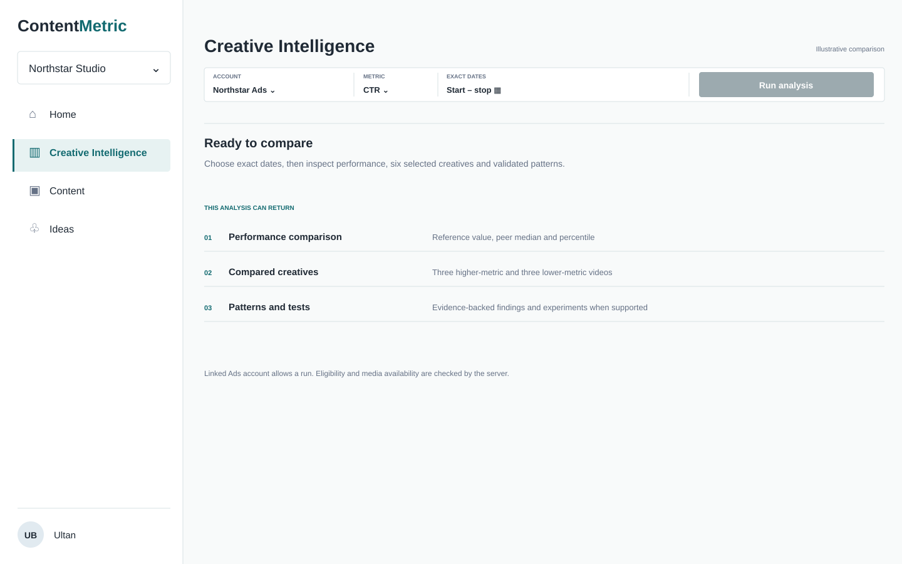 |
| Desktop full result | 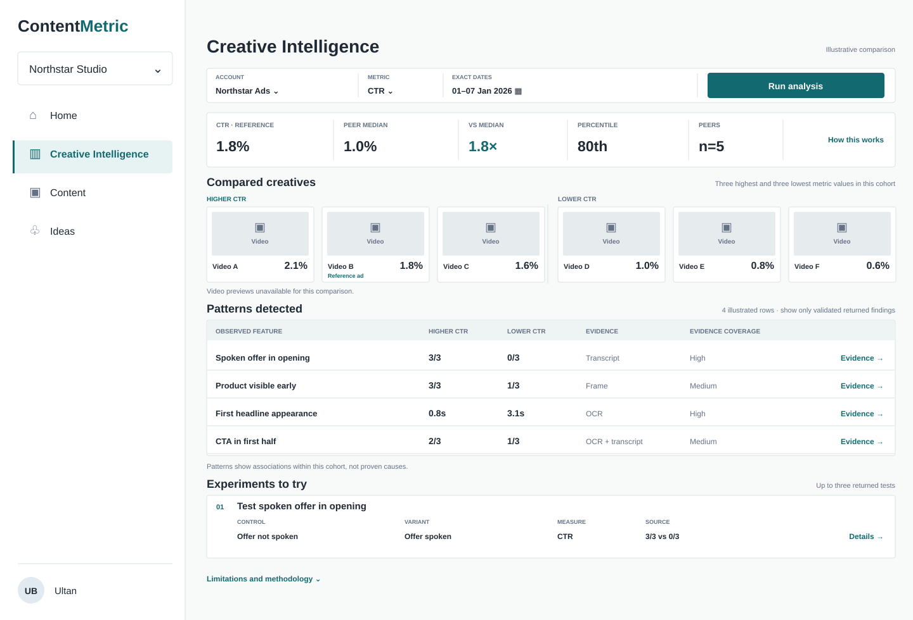 |
| Desktop evidence detail | 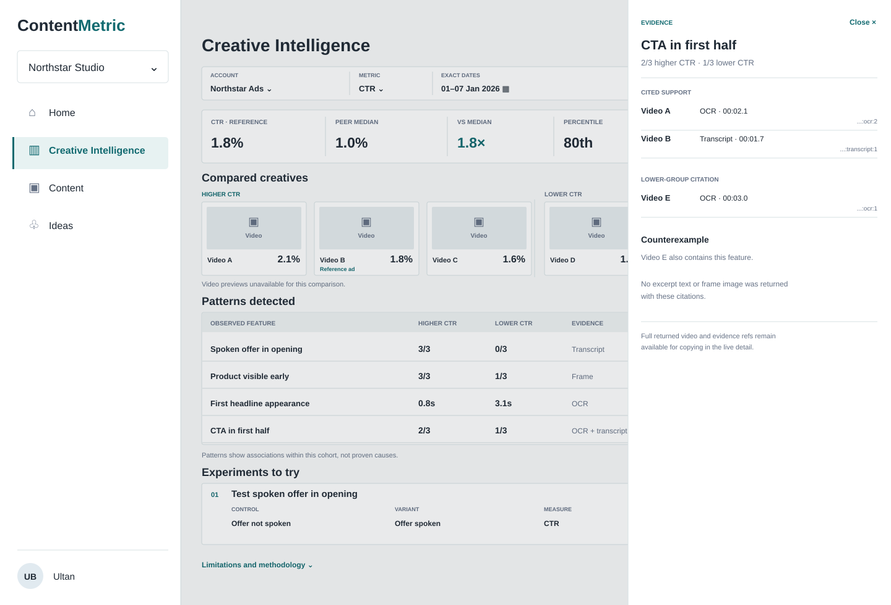 |
| Desktop performance-only result | 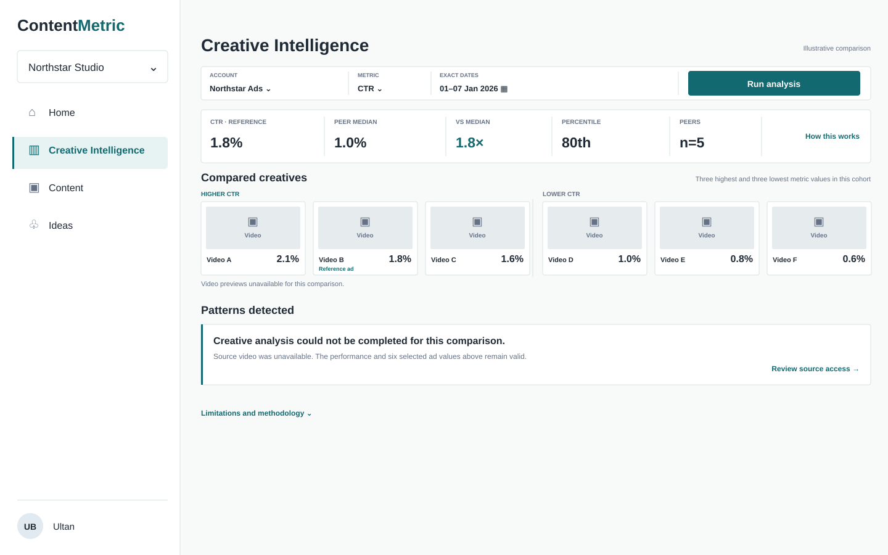 |
| Mobile full result | 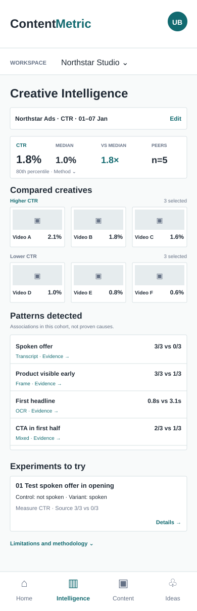 |
| Mobile evidence detail | 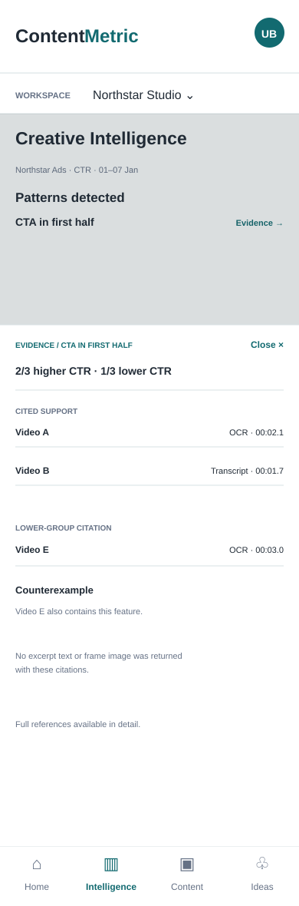 |
| Desktop no linked Ads account | 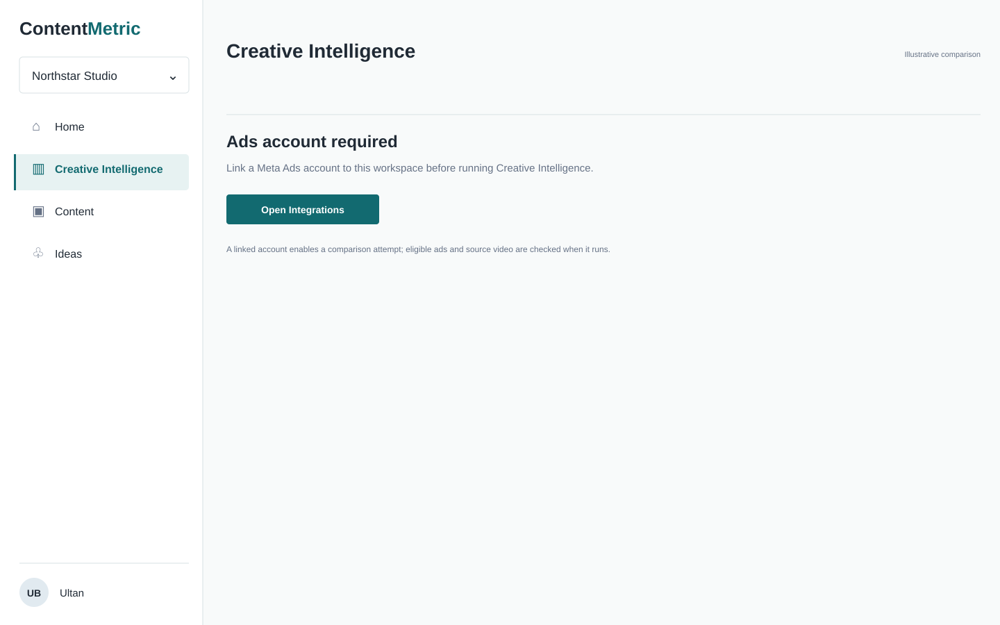 |

### Structural shift and density

| Rejected direction | V4 response |
|---|---|
| V1 mirrored the response as a form and report. | One 54 px control toolbar, an 86 px comparison strip, a six-item cohort roster, an aligned patterns matrix and short experiment rows. |
| V2 made the reading simple but concealed the depth of analysis. | All six selected creative references, their selected metric values, group membership, several validated differences and their evidence types are visible together. |
| V3 restored inspectable analysis but spent too much space on a performance hero, large finding modules and prose. | Performance becomes one data strip; four illustrated pattern rows fit in about 214 px; one experiment fits in about 99 px. Evidence opens beside the matrix rather than lengthening it. |

The target is roughly **2–3× more useful information in the first desktop viewport**, achieved by changing the structure, not just reducing padding. In the 1440 × 980 drawing, the toolbar begins at y=108, the performance strip at y=178, all six creatives occupy y=327–446, four pattern rows occupy y=506–720, and the first experiment begins at y=783. A typical 1440 × 900 viewport therefore shows the metric, peer comparison, six video references, four patterns and most of the first experiment before scrolling. This is a concept measurement, not a browser validation claim.

The primary view removes repeated median/cohort explanations, long observation paragraphs, raw support metadata, repeated causal caveats and full experiment rationale. One line says **“Patterns show associations within this cohort, not proven causes.”** Definitions, caveats, source references, counterexamples and full constants move behind **How this works**, **Evidence** or **Details**. A material limitation still appears beside the affected result.

### Final information hierarchy

1. **Toolbar:** one linked Meta Ads account, one of CTR/CPC/CPM/Impressions, exact start and stop dates, and **Run analysis**. Before a run it is editable. After a run it remains compact and identifies the returned comparison. On mobile, the summary opens an edit sheet with the same four inputs and one submit action. No presets or extra filters.
2. **Performance strip:** selected metric and returned reference value, peer median, ratio, percentile and peer count when each exists. Exact dates remain visible in the toolbar. The illustrative 1.8%, 1.0%, 1.8×, 80th percentile and n=5 are internally coherent mock values, not account facts. Never synthesize a missing field, add another metric, or interpret higher values as better. A tiny percentile marker may be used only if it plots a returned percentile; V4 does not need one.
3. **Compared creatives:** three higher-metric and three lower-metric members returned by the server, each with pseudonymous video reference and selected metric value. The reference member may be identified if returned. This roster is visually prominent because the user can see that the content findings relate to **specific compared ads**, not an abstract average. It also makes the six-video sample size apparent before any methodology reading. The group labels say *higher/lower CTR* in the example, never winner/loser; with CPC/CPM, the labels follow that metric without a quality judgment. Other eligible ads may exist outside the six selected members.
4. **Patterns detected:** a compact matrix of returned validated observations. Rows align observed feature, higher/lower support or returned timing median, evidence type, evidence coverage confidence and an **Evidence** action. Four rows illustrate the density target; the live UI shows only returned rows, even if there are fewer than three. It does not calculate a new percentage-point delta or claim statistical significance. Fixed column labels may organize server facts; observation language must preserve the returned meaning.
5. **Experiments to try:** up to three short rows grounded in returned hypotheses. The first scan reveals the test, control, variant, metric and source finding/support when present. **Details** reveals returned `variable_to_test`, `what_to_hold_constant`, source observation, counterevidence and limitations. No predicted uplift or generic recommendation.
6. **Method and limitations:** one quiet disclosure for metric definition, cohort details, coverage, counterevidence and returned limits. A partial failure is explained where its content would have appeared. Internal model provenance and raw responses never occupy the product view.

### Evidence interaction and data integrity

Clicking a pattern's **Evidence** action opens a right-hand desktop inspector over the current comparison. The table remains recognizable behind it. On mobile, the same action opens a touch-friendly sheet; closing returns to the triggering row and scroll position. Opening another row replaces the current evidence, avoiding an endless expanded document. The inspector groups supporting citations by higher/lower metric group and explicitly marks returned counterexamples. Each cited moment uses its returned `video_ref`, `evidence_type`, `timestamp_seconds` and `evidence_ref`; the full references need a copyable path even if the compact drawing abbreviates them. Focus moves into the inspector, Escape/Close returns it to the row, and the inspector scrolls independently.

**Current contract limit:** Stage 8.1 group members return video references and metric values but no thumbnail/frame URLs. Current citations return references, type and timestamp but no bounded transcript/OCR excerpt or image. The neutral media slots in these SVGs are *not actual thumbnails*; the visible “Video previews unavailable” note prevents that misunderstanding. The inspector likewise shows citations without invented quotations or frames. Actual creative thumbnails/playback or text excerpts would need a separate approved response/media contract. No raw prompt, raw model response or internal provenance is exposed. This is the one material gap between the requested ideal of showing actual ad imagery and what the locked response can support today.

The drawings' pattern descriptions, support values, timing values, evidence types, confidence labels and experiments illustrate permissible **shapes** only. They must be populated only from returned validated observations. Confidence describes evidence coverage, not causal certainty. Returned `timing` medians may occupy the same group columns as support counts, with clear units. A pattern with missing timing/support uses only the supplied form; no client analysis infers it from citations.

### Ready, loading, mobile and partial behavior

- **Ready:** one-sentence purpose, compact toolbar and three concise output categories: performance, compared creatives, patterns/tests when supported. The exact dates are blank until chosen; no fake preview result. The action is inactive only while required input is incomplete/invalid. A linked account permits a request, not a guaranteed cohort or video result.
- **Loading:** retain toolbar and page geometry; disable changing/submitting the active request and show **“Comparing performance and creative evidence…”** in the analysis region. No fake percentage, phases or time promise. If an older result stays visible, its original comparison context remains attached until replaced.
- **Mobile:** the selected comparison is one compact editable line; the metric strip is 83 px; six small creative slots appear in two three-item rows; four short findings fit in about 228 px; the experiment is 109 px. Evidence and experiment details remain collapsed. Bottom navigation remains fixed and content clears its safe area. If viewport width cannot fit three slots, the six-member roster scrolls horizontally with visible group headings and no data table overflow.
- **Performance-only:** keep valid comparison context, metric strip and any returned group members. Replace only the unavailable creative layer with one short explanation and one recovery action. Never render empty patterns or experiment placeholders. If some patterns are valid, keep them and scope the limitation to what failed.
- **No linked Ads account:** omit unusable controls, name the prerequisite and provide **Open Integrations**. If the user lacks permission to link an account, explain who can complete it.

| Other degraded condition | What stays visible | One recovery path |
|---|---|---|
| Insufficient comparison cohort | Account, metric, exact dates and any returned count; no invented peer median or six-member roster. | Edit comparison dates. |
| Media unavailable | Valid performance and returned group values; no invented video imagery or findings. | Review source access. |
| Insufficient analysed video coverage | Valid performance and any valid findings; a scoped coverage explanation. | Review available Content/source video. |
| Model or validation failure | Valid performance and previously validated findings, if any. | Run analysis again. |
| Invalid metric or date | Entered values and field-level guidance in the edit controls. | Correct the invalid field. |
| Expired session or revoked workspace access | Do not expose another workspace's cached result. | Sign in or restore access. |
| Backend unavailable | Preserve an older result only with its original context and stale label. | Try again. |
| Malformed response | Do not show unvalidated fragments as results; preserve inputs. | Try again. |

### Product decisions exposed

- **Actual images are outside the locked response.** V4 prioritizes the six returned ads as a cohort roster, but real thumbnails require an explicit future media delivery decision. Fake frames would falsely imply visual inspection is already inspectable in this UI.
- **The six are selected comparison members, not necessarily all eligible ads.** Show eligible and peer counts separately when returned; do not equate those totals with the six group members.
- **Metric direction is neutral.** “Higher CPC” means a higher number, not a better outcome. The UI never assigns good/bad creative labels.
- **Rows reflect returned validation.** The matrix may have zero to several rows; no four-row quota, client-side ranking, calculated percentage-point difference or fabricated confidence.
- **Citations are the proof path, not a media viewer.** The drawer/sheet can show only returned references and timestamps today. Excerpts and thumbnails are a future contract decision.
- **Results remain on demand.** Saved history, sharing, export and clicking a creative into a full viewer are not implied by these concepts.

## Public entry, authentication, and first workspace — final polish concepts

| Surface | Desktop | Mobile |
|---|---|---|
| Public landing | 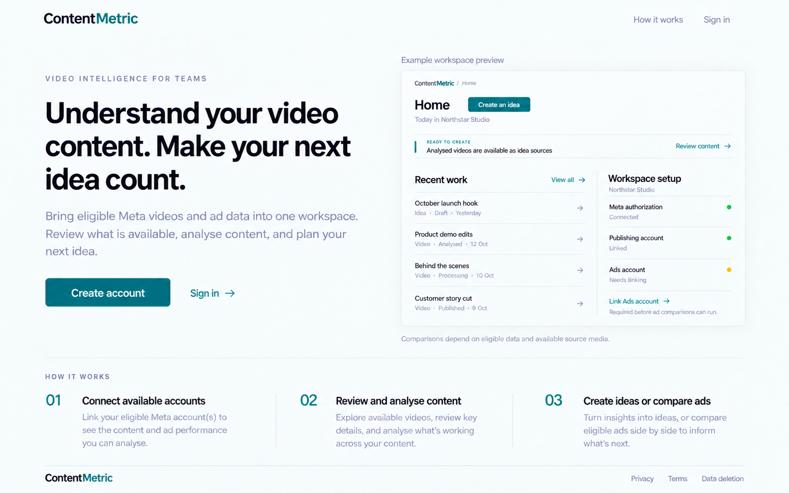 | 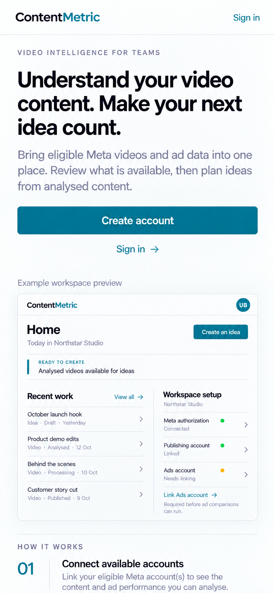 |
| Sign in | 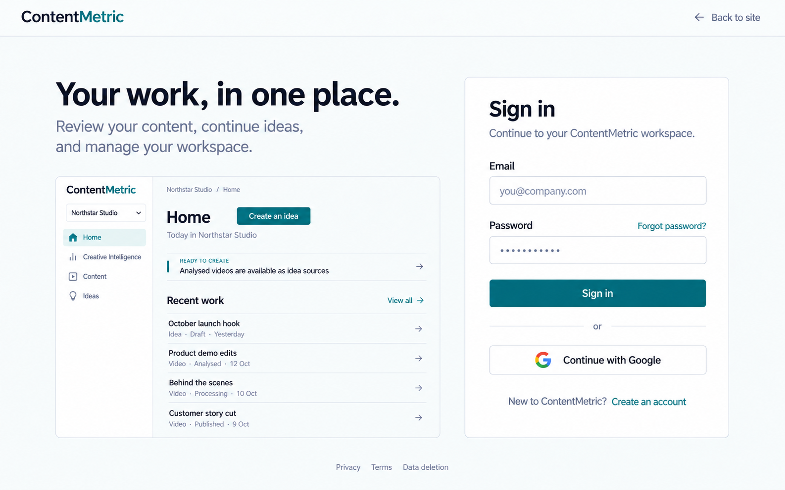 | 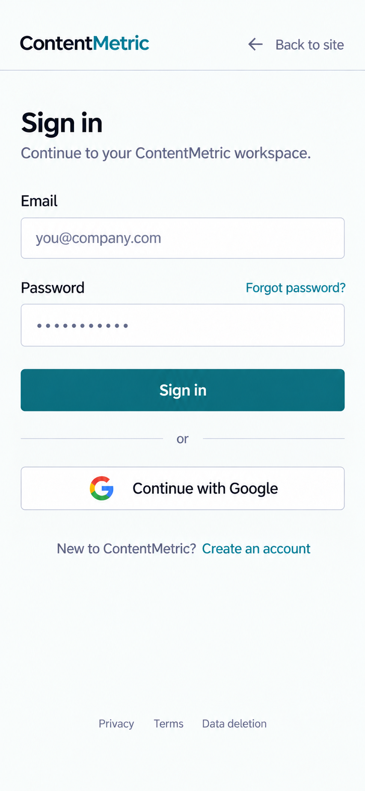 |
| Sign up | 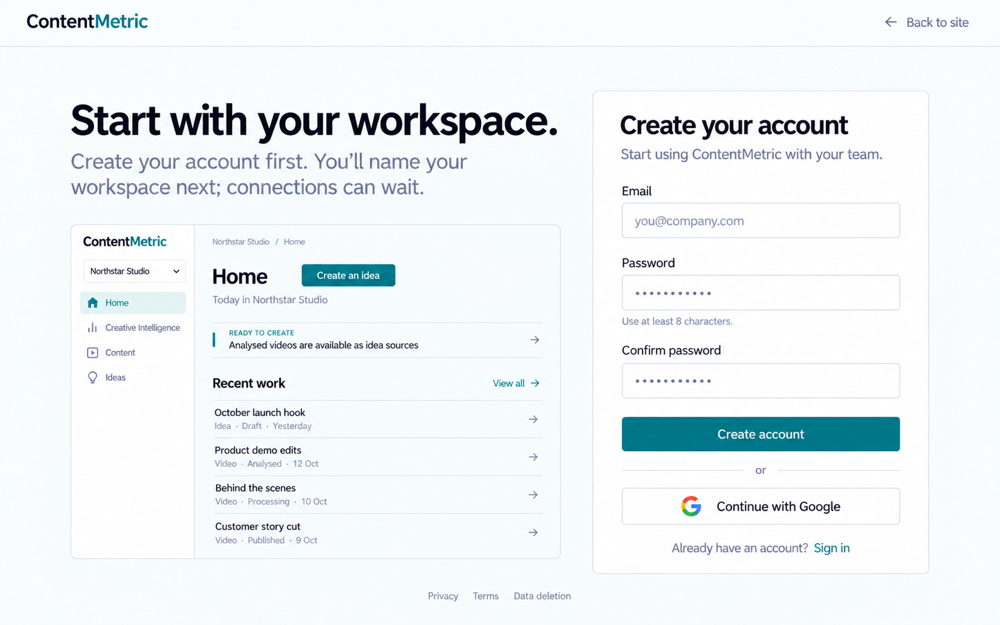 | 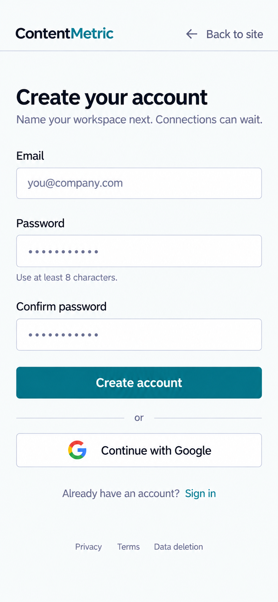 |
| First workspace | 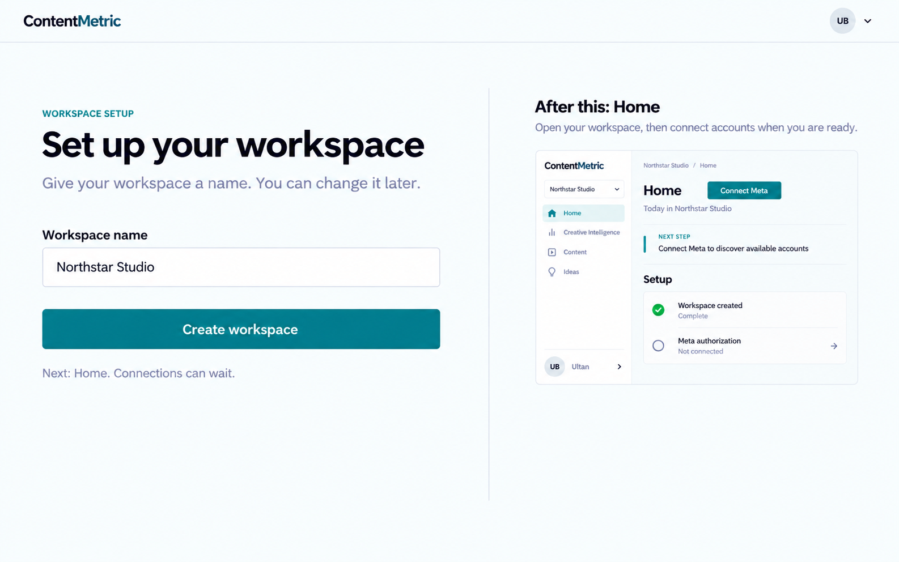 |  |

The `design/` folder groups each screen section separately. `v1/` preserves the first public/auth/onboarding concepts, `v2-final/` contains their final polish, and `authenticated-home/` retains its available V2 and locked V3 revisions.

### Final polish from the first public/auth/onboarding concepts

- **Landing:** shorter, more natural supporting copy while retaining `eligible` and `available` to avoid promising that every connected account has usable video or comparison evidence. The first viewport, primary CTA, example preview, workflow and footer stay as approved.
- **Login and signup:** slightly smaller mobile titles, tighter form rhythm, clear labels and password guidance, quiet `Back to site`, and the Google route remains secondary. No extra auth choices or signup fields.
- **First workspace:** the desktop Home preview is smaller and lighter so the name field and `Create workspace` remain the task. Mobile ends after `Next: Home. Connections can wait.` with no redundant second section.
- **Brand:** use one wordmark across public, auth, onboarding and the authenticated shell: `Content` in graphite and `Metric` in deep teal. The two Home V3 brand-alignment references below change only this mark; the approved shell layout stays locked.

### Final copy and token notes

The landing lead now reads: **“Bring eligible Meta videos and ad data into one workspace. Review what is available, analyse content, and plan your next idea.”** Mobile uses a shorter line with the same bounded meaning. The signup bridge remains **“Name your workspace next. Connections can wait.”** The one-field step ends with **“Next: Home. Connections can wait.”** These are proposed final strings for review; the generated rasters are visual references rather than authoritative text exports.

No new global palette, font, spacing scale or component language is introduced. Apply the existing `#202A35` graphite and `#126A70` deep teal to the wordmark consistently. Mobile auth titles target about 25–27 px, with helper text below and 16–24 px vertical form rhythm; labels remain legible and controls retain at least 44 px touch targets. The Google action stays a white, outlined secondary button with the standard multicolour G. During implementation, use a Google-rendered button or [Google's pre-approved brand assets and current button guidance](https://developers.google.com/identity/branding-guidelines), rather than a custom-drawn icon; the raster concept is only a visual approximation.

The landing page has one primary **Create account** action, **Sign in**, a labeled example product preview, and a concise three-part workflow. It omits Pricing and Help links until real destinations and verified claims are available. The auth screens use the same restrained type, colour, field, button, and border system as Home V3. The workspace screen is a dedicated one-field step; its example preview shows the **new workspace** Home state, with `Connect Meta` as the next action rather than an already available idea.

All names, dates, statuses, and product previews in these raster concepts are **illustrative**. The previews are labeled examples, not screenshots of live customer data. Copy and fine spacing in generated images require review before implementation. The concepts do not depict implemented routes or verified browser behaviour.

### Routing and first-run rules

| Condition | Proposed destination / behaviour |
|---|---|
| Unauthenticated visit to `/` | Show the public landing page. **Create account** opens signup; **Sign in** opens login. Public legal routes remain available. |
| Email signup without a session | Show `Check your email` confirmation state. After a valid confirmation callback and authenticated session, resolve workspace access before routing onward. Do not promise immediate access before verification. |
| Email signup with a session, Google sign-in, or normal sign-in | Resolve accessible workspaces after auth succeeds. Do not put workspace fields into the signup form. |
| Authenticated with zero workspace memberships | Route to the mandatory first-workspace screen. Creating the workspace makes it active and then takes the user directly to locked Home V3. |
| Authenticated with one accessible active workspace | Make it active and open its Home. A valid previously selected workspace takes precedence where applicable. |
| Authenticated with multiple accessible active workspaces | Restore a validated active/recent selection; if none can be resolved, show an explicit workspace chooser before entering Home. |
| Stored selection invalid, archived, or access revoked | Clear the stale selection and use an accessible workspace chooser/recovery state. Do not create a replacement workspace automatically. |
| Workspace list failed to load | Show retry/error recovery. Never infer `zero workspaces` from a failed request. |
| Authenticated with archived memberships only | Show selection/recovery, including a permitted restoration route where supported; do not treat this as a brand-new account. |
| Authenticated visit to public auth pages | Continue through workspace resolution unless password recovery or confirmation flow is active. |

The current release candidate differs: signed-out `/` redirects to login; workspace creation is inside Settings; onboarding can be skipped. This section is the **proposed design contract**, not a claim that those routes exist today. It supersedes the audit's earlier suggested goal-choice step before first entry: the new approved product decision is **mandatory workspace naming first, optional capability setup after Home**.

### Mandatory workspace step

- Require only a non-blank, trimmed **Workspace name**. The existing create request already accepts a name; the current UI limits it to 200 characters. The concept adds no company-profile, role, billing, Meta, Ads, or publishing fields.
- Keep **Create workspace** disabled until the name is valid. On submit, show a busy state and block duplicate requests. If creation succeeds but activation/navigation fails, recover the created workspace rather than creating another.
- Successful creation selects the new workspace and opens Home directly. It does not open Settings, another wizard, or a modal wall. There is **no Skip button**. Sign out remains available as an account control, not as a way into the product without a workspace.
- Inline validation and server errors preserve the entered name and give a retry path. Auth/session loss returns through sign-in without silently losing a successfully created workspace.
- The goal is one short field and one action, finishable in under 30 seconds for a typical user. No estimated time claim appears in the UI.

### First entry to locked Home V3

The shell and navigation stay exactly as approved. For a newly created workspace with no provider connection, Home names the active workspace, shows **Connect Meta** as the single primary action when the user is permitted to connect it, and explains that available accounts and content are discovered afterward. Its setup summary shows `Workspace created — Complete` and `Meta authorization — Not connected`. Recent work uses a compact empty state rather than sample rows; Ideas and Creative Intelligence remain navigable with honest prerequisite states. There is no blocking popup after creation.

If the user cannot manage connections, Home states that an owner must complete that step and uses a permission-appropriate action, such as opening the read-only setup explanation. It must not present a disabled owner action as the user's primary CTA. As real data arrives, Home chooses one dominant next action by eligibility, following the locked V3 readiness pattern.

### Optional setup and progress after entry

**Home owns the summary.** Its `Workspace setup` section shows the next relevant action and the current state of each prerequisite. A `View setup` disclosure or Home subview opens the full checklist; the user can reopen it from Home at any time. Actions lead directly to the relevant Integrations or Content task. This adds no primary navigation item and does not move workspace administration into the personal menu. If the summary is dismissed, a small `Setup` entry remains on Home.

Use capability groups rather than a single completion percentage:

| Capability | Honest prerequisite sequence | What Home can say |
|---|---|---|
| Workspace context | Workspace exists and is active | `Workspace created — Complete` |
| Ideas from content | Meta authorised → relevant publishing account linked → eligible content available → first analysis complete | Show the earliest actionable unmet step. `Ready to create an idea` only when analysed sources actually exist and the generation path is eligible. |
| Ads comparisons | Meta authorised → Ads account linked → user chooses account, metric, and exact dates → qualifying data evaluated on demand | `Ads account linked` means the user can attempt a comparison. Do not label Creative Intelligence results ready merely from linkage; cohort coverage and source-media evidence can still be insufficient. |

Statuses are named and scoped: **Complete**, **Needs action**, **Waiting/processing**, **Unavailable/error**, and where appropriate **Not yet known**. Text carries meaning; dots are supplementary. Meta OAuth, publishing-account linkage, and Ads-account linkage remain three distinct rows. Ads linkage can enable a performance comparison without guaranteeing observed creative differences or hypotheses. A returned partial result or abstention remains an honest result, not failed setup.

The setup summary shows only information that changes the next action. Detailed account assignment, connection errors, and permissions live in Integrations; content processing details live in Content. Users can continue exploring accessible product areas with partial setup. The old linear percentage bar is not the proposed model because Ideas and Ads comparisons have different prerequisites.

### Auth and onboarding interaction notes

- **Sign in:** labeled email/password, an explicit `Forgot password?` route, Google OAuth as supported by the current auth client, and a clear create-account path. Errors appear near the form with text, preserve the email, and identify retryable connection problems without exposing provider internals. Busy state prevents duplicate submits.
- **Sign up:** email, password, and confirm password only; keep the current eight-character minimum visible. Google is an alternative account path. If email confirmation is required, show a dedicated `Check your email` state, then resume the workspace resolver after verification.
- **Callbacks and recovery:** invalid or expired links provide a new-reset route and sign-in path. Session loading does not flash a false zero-workspace screen. Google callback returns to the same workspace-resolution logic.
- **Public site:** product preview is explicitly an example. Do not promise that every Meta connection yields downloadable media, a qualifying Ads cohort, or creative conclusions. Existing Privacy, Terms, and Data deletion destinations remain reachable. Pricing and Help wait for verified content/routes.
- **Mobile:** compact public/auth chrome, single-column forms, visible labels, 44 px minimum touch targets, keyboard-safe scrolling, and no authenticated bottom navigation before the workspace is created. The first-workspace screen stays one field and one action.

### Tokens for these surfaces

No new global colour, typography, icon, or spacing tokens are proposed. Reuse locked Home V3: sans-only type, `#F8FAFA` canvas, white restrained surfaces, graphite `#202A35`, deep teal `#126A70`, and cool 1 px rules. Surface-specific applications: public/auth header about 44–48 px mobile; auth form max width about 420 px desktop; form fields at least 44 px high; primary buttons at least 44 px touch target; focus outline and error text follow the existing semantic pattern. The landing preview may use one thin framed surface to distinguish the **example** from the live page.

## V3 visual concepts — approved and locked authenticated direction

### Desktop · authenticated shell and Home

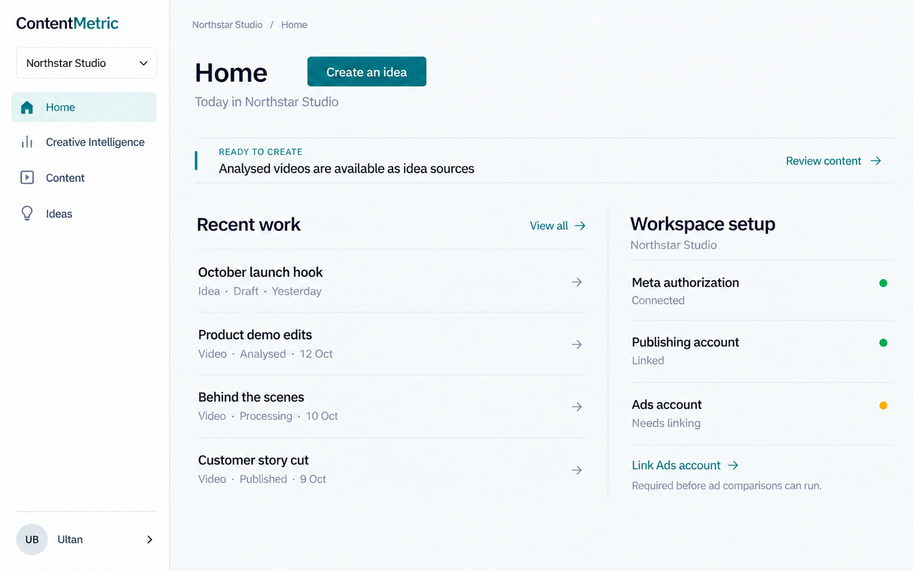

The primary `Create an idea` action now sits with the `Home` heading. Readiness is a concise white status row with a label, message, thin rules, and a secondary `Review content` action. Recent work and workspace setup share a heading baseline, row rhythm, and one light column divider. The four primary destinations, workspace selector, and separate profile control remain as approved.

### Mobile · authenticated shell and Home

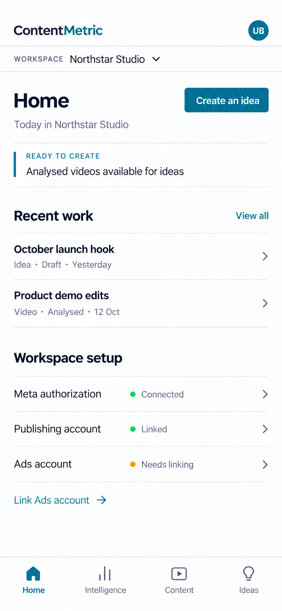

The brand/profile toolbar is shorter and the workspace selector is a flat, single-line navigation row. The primary action remains beside `Home` with less visual weight. Readiness, two recent items, and the three distinct setup states remain visible above the persistent four-item bottom navigation.

### Polish changes from V2

- Brought the desktop CTA into the page-heading group without enlarging it.
- Replaced the tinted readiness panel with a compact, mostly white actionable row; removed its decorative lightning icon.
- Aligned the desktop columns and refined shared divider and row spacing without enclosing them in a card.
- Compressed mobile top chrome and converted its workspace selector from a two-line field-like block to a one-line navigation control.
- Tightened mobile action and section proportions; retained `Home` as the dominant page label.
- Standardised small status dots, lightweight row chevrons, and navigation icon weight. Status text remains explicit: `Connected`, `Linked`, and `Needs linking`.

### Final visual-system adjustments

These refinements supersede only the corresponding V2 rows below; the approved information architecture and interaction model are unchanged.

| Role | V3 refinement |
|---|---|
| Heading and label hierarchy | Sans-only. Page title about 30 px desktop / 24 px mobile; section headings about 20 px desktop / 18–20 px mobile; readiness label 11–12 px semibold. Keep body 14–15 px and metadata 12–13 px with readable contrast. |
| Primary action | Place beside the page title within its content group on desktop, beside `Home` on mobile. Medium button, around 40–44 px visible height with at least a 44 px touch target; one dominant action for the current state. |
| Readiness surface | White or near-white, 1 px top/bottom rules and a 2–3 px accent rule; no gradient, large tinted panel, shadow, or decorative icon. Keep its message and secondary navigation action. |
| Information region | Align column headings and first row; use one quiet vertical rule and matching row dividers. Recent items retain type, status, date, and destination cue. |
| Mobile chrome | Target roughly 44–48 px brand/profile toolbar plus a 36–40 px flat workspace row, excluding safe-area insets. Workspace name remains visible; long names truncate visually with the full accessible name. |
| Icons and status | One outline family and optical weight across primary nav and bottom nav; small consistent chevrons. Status dots about 6–8 px, paired with text. Green denotes completion of the named step only; amber denotes required action. |

The screenshots remain **illustrative design assets**. Sample workspace, item names, dates, source readiness, and integration states are not live product data. In particular, Meta authorization and a linked publishing account do not imply an Ads account is linked or that a comparison can produce creative evidence.

## V2 visual concepts — approved structural direction, retained for comparison

The earlier V2 images are not part of the current document artifact set; this section preserves the design decisions that led to locked V3.

### Desktop · operational Home

The desktop keeps the approved sidebar and menu scopes. `Home` is the page identity. A single medium primary action sits beside the heading. A compact readiness band explains why it is available; recent work uses four direct rows with type, status, and date; workspace setup shows Meta authorization, publishing linkage, and Ads linkage separately. Open columns and hairline rules carry the information without a grid of cards or a second set of feature links.

### Mobile · compact working view

The mobile concept retains the four-item bottom navigation and separate profile/workspace controls. The workspace selector behaves visually like a compact navigation row. The first viewport shows the primary action, readiness, two recent items, and all three setup states above the bottom bar. `Intelligence` is the short visible bottom-bar label; the destination and accessible name remain **Creative Intelligence**.

Both V2 images use **illustrative sample data**. `Northstar Studio`, item names, dates, analysed-source availability, and integration states are design examples, not verified account data. The pictured `Create an idea` action assumes eligible analysed content. `Ads account · Needs linking` is deliberately separate from Meta authorization and publishing linkage; linking an Ads account permits a comparison request but does not guarantee a qualifying cohort, source media, or a creative result.

### Changes from V1

1. Replaced the large editorial serif and greeting with a restrained sans-serif `Home` heading and workspace context.
2. Reduced header, workspace selector, button, and section spacing; the mobile first viewport now contains useful work and setup state.
3. Replaced repeated desktop destination links with a compact readiness row and more informative recent-work rows.
4. Made the three integration stages explicit, including an Ads-linking action, without claiming full intelligence readiness.
5. Kept one primary action and the approved desktop/mobile navigation and menu separation.

### V2 visual rationale

The main scan path is **where am I → what can I do → what changed → what needs setup**. A neutral software canvas and compact type make the work itself prominent. The readiness band is the only coloured content surface; status dots support text labels rather than replacing them. Recent work is a list because each row is a destination, while connection status is a short checklist of distinct prerequisites. This raises useful density without creating a KPI dashboard.

### V2 design-system changes

The following values supersede the V1 values below. All unlisted interaction and accessibility principles remain proposed as written.

| Role | V2 proposal |
|---|---|
| Typography | Sans-serif throughout. Prefer a highly legible UI face such as Inter or a system sans stack; no display serif. Typeface choice remains a design decision, not an added dependency. |
| Type scale | Page title 30–32 px desktop / 24–26 px mobile; section title 20–22 / 18–20; body 14–15; metadata 12–13. Use semibold titles and regular body. |
| Background and surfaces | Cooler near-white `#F8FAFA` canvas, white navigation and menus; content sections stay mostly unboxed. Use one faint tinted readiness band, not large cards. |
| Text and accent | Ink `#202A35`, secondary `#667284`; deep teal accent `#126A70`, hover `#0E555A`, selected wash `#E8F3F4`. Semantic status colours remain separate. |
| Borders | Cool neutral `#DCE3E7` 1 px dividers. Separate list rows and columns without wrapping every area. |
| Spacing and density | 4, 8, 12, 16, 20, 24, 32, 40 px scale. Section rhythm about 24–32 px desktop / 20–24 px mobile. Sidebar about 226–232 px; content max width about 1,080 px. |
| Mobile chrome | Brand row about 48 px, workspace row about 40 px, bottom navigation about 64 px plus safe area. Compact primary action about 40–44 px high and sized to its label. |
| Navigation states | Keep the selected wash and narrow accent marker on desktop; selected icon and label on mobile. Hover uses a subtle neutral wash; focus uses a visible accent outline. |

### Remaining product questions

- What is the canonical order for mixed recent work, and should `View all` open a combined activity view or the most relevant existing destination?
- Which exact eligibility signal enables `Create an idea`, and what owner/member-specific action replaces it when sources or connections are missing?
- What wording should the Ads status use after account linkage when comparison eligibility or source-media coverage is still unknown?
- The approved profile menu includes `Account settings`, but the release candidate has no personal account-settings screen. What supported controls will that destination contain?

## V1 visual concepts — retained for comparison

The V1 images are not part of the current document artifact set; this section records the superseded exploration.

### Desktop · authenticated shell and Home

The approximately 232 px sidebar holds the product identity, an always visible workspace selector, and exactly four primary destinations: **Home**, **Creative Intelligence**, **Content**, **Ideas**. The selected item has a quiet tinted ground and a narrow accent rule. The personal profile control sits at the bottom, away from workspace controls. A slim content header repeats the active workspace name; the Home page has a single primary action, one contextual next step, recent work, setup status, and unobtrusive entry points into the other product areas. The content column is capped at roughly 1,080 px so large displays keep a readable line length.

### Mobile · authenticated shell and Home

The compact header keeps **Northstar Studio** visible as a workspace selector and gives the profile its own control. One persistent bottom bar provides the four primary destinations; **Intelligence** is the short visible label for **Creative Intelligence**, whose full name should remain available to assistive technology. The page is a single column with the same action and information order as desktop. The bottom bar is the only mobile feature navigation; workspace administration lives in the workspace menu.

Both images are **illustrative visual concepts**. Northstar Studio, Ultan, recent item titles, dates, readiness, and connection status are sample content, not verified account data. Text and spacing in generated raster concepts are directional; final copy and dimensions need review during implementation. The images do not depict an implemented or tested UI.

## V1 rationale — retained for comparison

- **Orientation first:** the active workspace is named in the selector and page context before a user encounters any task. Workspace and personal actions use separate controls.
- **One useful action:** Home chooses a primary action from real readiness. The pictured `Create an idea` state assumes an eligible analysed source exists. The next step explains why that action is available.
- **Work over metrics:** recent content and saved ideas have useful destinations. Connection status is visible without a dashboard of counts or decorative charts.
- **Progressive disclosure:** primary navigation stays at four destinations; integrations, billing, settings, switching, and account actions appear in their respective menus.
- **Quiet visual identity:** editorial display type, graphite text, warm neutral ground, pine green action colour, and thin rules provide character without mimicking Stripe or Supabase.

## V1 proposed design system — superseded by V2 values above

These are proposed design tokens for review, not CSS or a dependency decision.

| Role | Proposed value / rule |
|---|---|
| App background | Warm neutral `#F7F7F4` |
| Raised surface | `#FFFFFF`; reserve for menus, inputs, dialogs, and occasional focused panels |
| Subtle selected surface | Pale pine `#EAF3EE` |
| Accent / primary action | Deep pine `#176B57`; darker hover `#125440`; soft focus halo derived from accent |
| Primary / secondary text | Graphite `#1D2523` / slate `#59635F` |
| Quiet text | `#69736F`, subject to contrast verification at actual sizes |
| Borders / separators | `#DCE2DE`, 1 px; use open whitespace before adding containers |
| Display type | Newsreader or similar restrained editorial serif for greeting and major section headings; test available weights and fallback before adoption |
| UI type | DM Sans or similar clear sans; system sans fallback. Menus, controls, labels, and body remain sans |
| Type hierarchy | Page greeting 40–48 desktop / 32–36 mobile; section 24–28 / 22–24; body 15–16; navigation 14–15; metadata 12–13. Use weight and spacing before colour to build hierarchy |
| Spacing scale | 4, 8, 12, 16, 24, 32, 48, 64 px. Main section rhythm 48–64 desktop / 32–40 mobile |
| Radii | 8 px controls and inputs; 10–12 px menus; 12 px rare panels. Lists and page sections usually have no enclosing radius |
| Primary button | Solid pine, white label, 44–48 px minimum height; one per view/state. Darker on hover, visible 2 px focus ring |
| Secondary / text actions | White or neutral with 1 px border; text link uses accent and an arrow only when it denotes navigation |
| Input | White field, quiet border, 44 px minimum height, visible label above, helper/error below. Focus ring and error text supplement border colour |
| Navigation | Selected: pale pine and accent rule; hover: neutral wash; keyboard focus: clear accent outline; disabled: label plus explanation where relevant |
| Menus | White anchored popover, thin border, restrained shadow, 8–10 px item spacing; explicit group labels for workspace versus personal scope |
| Icons | Sparse 18–20 px outline icons of one family, consistent stroke; accompany labels in navigation and status, never carry meaning alone |
| Empty state | Plain heading, one sentence explaining the missing prerequisite, one direct action; no decorative illustration required |
| Loading | Preserve page structure with quiet row skeletons or a labelled progress state; avoid replacing the whole shell or shifting the primary action |

Status colours are semantic and separate from the brand accent. `Meta connected`, publishing-account links, and Ads-account links must be represented as different states; a green connection dot alone does not imply an Ads comparison is ready.

## Key interaction notes

1. **Workspace menu:** selector opens a labelled menu with `Switch workspace`, `Integrations`, `Billing`, `Workspace settings`. The current workspace is identified in the menu and remains visible after closing it. Workspace-scoped destinations must name their target workspace, particularly if an inspection flow can differ from the active workspace.
2. **Profile menu:** separate control opens `Account settings` and `Sign out`. `Account settings` is a proposed destination; the release candidate does not yet have a personal account settings screen. Do not add an inert link merely to complete the menu.
3. **Home action:** choose exactly one primary action by state: create an idea when analysed sources are eligible; review Content when items exist but analysis is needed; connect/link Meta when required and permitted; choose/create a workspace when none is active. Show a direct, permission-aware next step for members who cannot manage connections. Do not promise that connection alone supplies usable source media.
4. **Recent work:** use real saved ideas and published/analysed content only. Each row opens its relevant destination. When absent, show one compact empty message and an appropriate action, without fabricated activity.
5. **Integration status:** indicate OAuth connection, publishing-account linkage, and Ads-account linkage distinctly. Show a direct `Manage integrations` action when setup or reconnection is needed. Keep the full details within the integration destination.
6. **Mobile:** keep four destinations available in the persistent bottom bar, with the full Creative Intelligence name in its accessible label. Workspace and profile menus remain separate at the top. Allow a long workspace name to truncate visually while its full name is accessible. Content scrolls above the bottom bar and respects safe areas.
7. **Menus and focus:** support keyboard open/close, Escape, focus return, visible focus, selected-page announcement, and touch targets of at least 44 px. Validate contrast, 200–400% zoom, long names, and small landscape view when implemented. Respect reduced motion; motion, if any, is limited to short menu and state transitions.

## Product decisions exposed by this concept

- **Ideas** is proposed as one primary destination containing distinct Create and Library views. The picture's `Create an idea` button assumes that route can open Create directly; the current release candidate has separate Generate and Ideas destinations.
- **Creative Intelligence** remains a primary destination even when an Ads comparison cannot run. Home must avoid implying a result is ready just because Meta OAuth is connected. The current comparison concept is specified in Creative Intelligence V8 above.
- **Account settings** needs a supported scope and content before its menu item becomes actionable. The release candidate only exposes email and sign out.
- **Home readiness** needs one agreed priority order when multiple needs coexist, and clear copy for members without owner permissions. The proposed priority in the interaction notes is for product review.
- **Workspace scope** should be canonical for Integrations and Billing. A user must not see an active-workspace label while acting on an unlabelled different workspace.

## Scope and verification

This planning document and all concept images are design artifacts only. The eight final public/auth/first-workspace concepts and two brand-only V3 Home variants were saved in `design/` and mirrored to the release-candidate worktree's `design/` directory at `/private/tmp/v9-stage8-intelligence-ui/design/`. The approved V3 Home layouts remain unchanged. No application code, backend behaviour, route, dependency, commit, tag, or deployment was changed. I reviewed the corrected audit, locked Home V3, and the release candidate's auth, workspace, and onboarding source read only. All final images were visually inspected; no app build, browser flow, live provider connection, accessibility audit, or user validation was run for this design-only phase.
